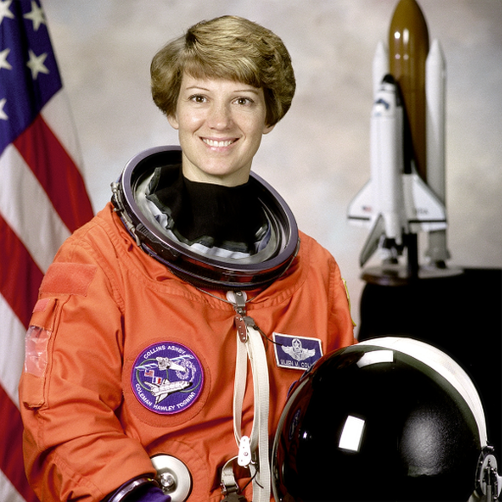

# NVIDIA N1X NPU on Linux

[](https://github.com/johannhartmann/n1x-npu-linux/actions/workflows/offline.yml)
[GPL-2.0-only + MIT](LICENSING.md) · [Setup](docs/setup.md) · [Support status](docs/status.md) · [Updates](docs/updates.md) · [Contributing](CONTRIBUTING.md)

Experimental Linux driver and **NVIDIA cuDLA backend for the N1X NPU/DLA** in
the ASUS ProArt P16 H7607BA / RTX Spark. Run real inference through NVIDIA's
original Linux cuDLA frontend, rebuild the checked model fixtures, and explore
the recovered firmware and driver protocols.

The implementation was reconstructed from NVIDIA's Windows ARM64 driver and
checked against original-code emulation, public Jetson sources and physical
P16 execution. A Windows installation is not required. Vendor libraries,
firmware and compiler inputs are acquired separately and verified by hash.

## See it run

The complete 3× super-resolution output below came from the physical N1X DLA.
Open the result for the full 1536×1536 image.

<table>
<tr><th>Input · 512×512</th><th>N1X DLA output · 1536×1536</th></tr>
<tr>
<td><a href="demo/assets/astronaut-input.png"></a></td>
<td><a href="demo/assets/astronaut-dla-3x.png"></a></td>
</tr>
</table>

NASA sample, distributed by scikit-image. [Image provenance and hashes](demo/assets/README.md).
The learned four-convolution graph runs on DLA; CPU work handles image preparation,
chroma resizing, pixel rearrangement and independent validation.

**[Run the demo →](demo/README.md)**

Additional examples: [full-image DnCNN denoising and ResNet-18 classification](demo/vision.md),
with physical NPU convolutions, explicit CPU stages and independent numerical checks.

## Supported platform

Physical support is pinned to **ASUS ProArt P16 H7607BA**, BIOS **H7607BA.300**,
and kernel **7.2.8-23-omarchy-p16-asus-npu2** with matching headers. These guards
are enforced by the driver. Other N1X hardware and kernels need a separate port
and qualification. Start with the related [P16 Linux setup](https://github.com/johannhartmann/asus-proart-p16-rtx-spark-linux)
for workstation enablement; this repository supplies the NPU implementation and
research tools, not a generic distribution/kernel installer.

| Capability | Physical evidence on this P16 |
| --- | --- |
| Firmware startup and cuDLA ReLU / Conv / Conv → ReLU | 48 numerical jobs matched independent references exactly |
| Completed-task I/O reuse | Changing inputs, 15 fixture REEXECs, one allocation per loaded graph |
| Healthy shutdown and module reload | Two cycles with zero retained backing, normal unload and successful inference after reload |
| Complete 3× super-resolution | 512×512 → 1536×1536 and 1024×1024 → 3072×3072; 461 DLA windows and whole-image reference checks |
| DnCNN denoising and ResNet-18 classification | [Six image runs, 657 NPU submissions](docs/evidence/vision-hardware-2026-10-29.json); independent numerical checks and bounded reuse across images |

[Exact versions, hashes and measurements](docs/evidence/npu-hardware-2026-10-28.json)
· [Current limits](docs/status.md)

This is a manually operated experimental driver. The transport requires
`CAP_SYS_RAWIO` and trusted models; metadata checks do not sandbox embedded
instructions. Healthy shutdown releases retained DMA. Uncertain firmware/DMA
failures preserve allocations and lifetime references until reboot.
Automatic suspend/resume, failed-channel recovery, general ONNX/TensorRT model
compilation, asynchronous scheduling and CUDA Graphs are unsupported.

## Get started

**To use the NPU:** follow [setup and reproduction](docs/setup.md), then the
[super-resolution demo](demo/README.md). Setup covers the exact platform,
pinned vendor inputs, offline compilation and explicit hardware startup.

**To explore or contribute without NVIDIA hardware:**

```sh
git clone https://github.com/johannhartmann/n1x-npu-linux.git
cd n1x-npu-linux
make test                      # C compiler + make only
python3.12 -m venv venv
venv/bin/python -m pip install --require-hashes --only-binary=:all: -r requirements.lock
make check                     # consistency + portable protocol/lifetime tests
```

These checks need no vendor files, GPU or root. `make help` lists the build and
test targets. Building a module does not install or load it. Hardware commands
are separate and preserve the selected power profile.

## Architecture

```text
unprivileged image/validation application
  → fixed binary protocol → root-owned capability-confined broker
  → CUDA buffers
  → NVIDIA's original libcudla.so.1
  → this project's libnvcudla.so backend
  → blocking CUDA staging + RAWIO-only Linux accel transport
  → Linux driver → extracted firmware → physical N1X DLA
```

[cuDLA API and backend](docs/cudla-backend.md) · [Shutdown and reload](docs/shutdown-reload.md)

## Repository map

| Path | Contents |
| --- | --- |
| `driver/`, `include/`, `patches/` | Kernel implementation, UAPI and scoped kernel patches |
| `runtime/` | cuDLA backend, model materialization and application bindings |
| `demo/` | Super-resolution, denoising and classification examples |
| `scripts/`, `tests/` | Operational commands, research tools and regression harnesses |
| `docs/` | Maintained setup, architecture and support guides |
| `docs/evidence/` | Immutable measurement and reproduction receipts |
| `docs/research/` | Detailed protocol, firmware, compiler and historical boot investigations |

[Documentation index](docs/README.md) · [Tool index](scripts/README.md) · [Development guide](CONTRIBUTING.md)

Local vendor inputs, generated loadables, environments and logs stay in ignored
`sources/`, `results/` and `venv/`. Research reports retain their dated observations;
[status](docs/status.md) is the current support summary.

## Contribute and report issues

Read [CONTRIBUTING.md](CONTRIBUTING.md) for the test matrix and contribution workflow.
Use [GitHub issues](https://github.com/johannhartmann/n1x-npu-linux/issues/new/choose)
for reproducible bugs and feature requests, and [SECURITY.md](SECURITY.md) for
security-sensitive reports. Related work: [P16 Linux setup](https://github.com/johannhartmann/asus-proart-p16-rtx-spark-linux)
and [spark_hwmon telemetry](https://github.com/johannhartmann/spark_hwmon).

Kernel components use **GPL-2.0-only**; userspace and analysis components use
**MIT**, subject to existing file-level notices. See [LICENSING.md](LICENSING.md)
and [NOTICE](NOTICE). NVIDIA/ASUS product names identify the hardware and
vendor interfaces; this is an independent community project.
