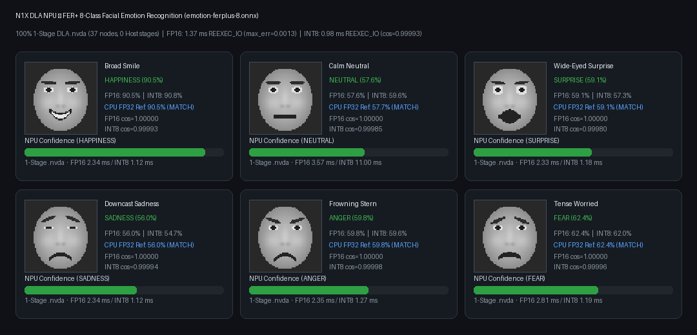

# NVIDIA N1X NPU on Linux

[](https://github.com/johannhartmann/n1x-npu-linux/actions/workflows/offline.yml)
[GPL-2.0-only + MIT](LICENSING.md) · [Architecture](docs/architecture.md) · [Setup](docs/setup.md) · [Status](docs/status.md) · [Updates](docs/updates.md) · [Contributing](CONTRIBUTING.md)

Linux kernel driver (`n1x_npu_bootstrap.ko`), **native `t254` compiler (`FP16`/`INT8`)**, **heterogeneous ONNX Execution Provider (`N1xInferenceSession`)**, and **NVIDIA cuDLA backend** for the NVIDIA N1X NPU/DLA (`NVDA200A` / `NVDA8600`) in the ASUS ProArt P16 H7607BA / RTX Spark.

## Demos

### 1. 3× Super-Resolution (`./demo-superres`)

<table>
<tr><th>Input · 512×512</th><th>N1X DLA output · 1536×1536</th></tr>
<tr>
<td><a href="demo/assets/astronaut-input.png"></a></td>
<td><a href="demo/assets/astronaut-dla-3x.png"></a></td>
</tr>
</table>

**[Run `./demo-superres` →](demo/README.md)** · [Image hashes & provenance](demo/assets/README.md) · [DnCNN denoising & ResNet-18 classification (`./demo-denoise`, `./demo-classify`)](demo/vision.md)

### 2. Heterogeneous ONNX Execution Provider (`./demo-onnx`)

End-to-end execution of ONNX Model Zoo's `emotion-ferplus-8.onnx` (37 nodes lowered into a single `t254` `.nvda` loadable, `1.37 ms` in `FP16` and `0.98 ms` in auto-calibrated `INT8` via `REEXEC_IO`, `6/6` top-1 agreement with the FP32 reference):

<p><a href="demo/assets/emotion-ferplus-gallery-dla.png"></a></p>

```sh
./demo-onnx --model emotion --precision fp16 --output-dir results/emotion-ferplus-fp16
./demo-onnx --model emotion --precision int8 --output-dir results/emotion-ferplus-int8
```

**[Run `./demo-onnx` (`emotion`, `mnist`, `superres`) →](demo/README.md#heterogeneous-onnx-execution-provider-demo-demo-onnx)**

## Features & Hardware Support

- **Dynamic ACPI & VBIOS Discovery (`strict_platform=0`)**: Binds `NVDA200A` (`_HRV=0x34`) and `NVDA8600` (`_HRV=1` `SROOT`) via `<linux/component.h>`, discovers `_CRS` MMIO apertures and IORT SMMUv3 mappings dynamically, and parses the live VBIOS BIT `0x6c` clock/gating policy from the hardware carveout (`0x1182bc80`).
- **In-Kernel Bring-Up, PM & Frequency Scaling (`autostart=1`)**: Executes the 8-stage HFRP/SROOT bring-up in C on probe, supports `.suspend` / `.resume` power transitions, and exposes `/sys/bus/platform/devices/NVDA200A:00/npu_freq_khz` (`892.8 MHz`–`1500 MHz`, `2.31x` throughput boost).
- **`/dev/accel/accel0` DRM Accelerator**: Supports `EXEC`, `REEXEC` (in-place I/O patching with zero DMA allocations), `READ`, `STATS` (v2 hardware layer profiling), `CONTROL` (HAL-1 checkpoint preemption & resume), zero-copy read-only `mmap()` (`N1X_DLA_CAP_MMAP`), and automatic per-FD `postclose()` DMA cleanup.
- **Native `t254` Compiler & ONNX Execution Provider**: [`runtime/libn1x_compiler.so`](runtime/n1x_compile.cpp) and [`runtime/libn1x_ort.so`](runtime/n1x_ort.cpp) ([`N1xInferenceSession`](runtime/n1x_ort.py)) compile and execute `FP16` (`CHW16`) and `INT8` (`CHW32`, per-tensor and per-channel) multi-branch DAGs in-process with SHA-256 `.nvda` caching.

| Capability | Measured Result on NVIDIA N1X (`t254`) |
| --- | --- |
| cuDLA ReLU / Conv / Conv → ReLU & reload | 48 jobs, 15 `REEXEC`s, 2 full stop/unload/reload cycles |
| 3× super-resolution (`./demo-superres`) | 512×512 → 1536×1536 (`0.856 s`) and 1024×1024 → 3072×3072 (`2.181 s`), `RMSE <= 0.000162` |
| DnCNN denoising & ResNet-18 (`./demo-denoise`, `./demo-classify`) | 657 NPU submissions; DnCNN PSNR `20.73 -> 31.83 dB`, ResNet-18 top-1 exact match |
| ONNX Execution Provider (`./demo-onnx`) | `emotion-ferplus-8` (`1.37 ms` `FP16` / `0.98 ms` `INT8`), `mnist-12` (`0.33 ms`), `super-resolution-10` (`1.04 ms`) |
| Dynamic frequency scaling (`npu_freq_khz`) | `892.8 MHz` → `1500 MHz` (`224.2 ms` → `97.1 ms` on 64-tile super-resolution, `2.31x` speedup) |

## Quick Start

**Build and run portable tests (no NPU hardware or vendor files required):**

```sh
git clone https://github.com/johannhartmann/n1x-npu-linux.git
cd n1x-npu-linux
python3.12 -m venv venv
make check
```

**Build kernel module, compiler, and ONNX runtime:**

See [docs/setup.md](docs/setup.md) for vendor firmware/compiler acquisition and [docs/updates.md](docs/updates.md) for building and installing the `n1x-npu-driver` Arch package (`scripts/build_arch_module_package.py`).

## Repository Layout

| Path | Contents |
| --- | --- |
| `driver/`, `include/`, `patches/` | Kernel module (`n1x_npu_bootstrap.ko`), `/dev/accel/accel0` UAPI (`uapi/n1x_dla_accel.h`), compiler/ORT C ABIs (`n1x_compiler.h`, `n1x_ort.h`), and kernel patches |
| `runtime/` | Native `t254` compiler (`libn1x_compiler.so`, `n1x-compile`), ONNX EP (`libn1x_ort.so`, `n1x-ort-run`, `n1x_ort.py`), and cuDLA backend (`libnvcudla.so`) |
| `demo/` | `./demo-onnx`, `./demo-superres`, `./demo-denoise`, and `./demo-classify` |
| `packaging/`, `config/` | Arch `PKGBUILD`, `systemd` service (`n1x-npu.service`), and `udev` rules (`99-n1x-npu.rules`) |
| `scripts/` | Qualification tools, packaging helpers, and unit/fault-injection test suites |
| `docs/` | [Architecture](docs/architecture.md), [setup](docs/setup.md), [status](docs/status.md), [shutdown/reload](docs/shutdown-reload.md), [cuDLA backend](docs/cudla-backend.md), and [packaging/updates](docs/updates.md) |

## License

Kernel components are licensed under **GPL-2.0-only**; userspace and test components are licensed under **MIT** ([LICENSING.md](LICENSING.md), [NOTICE](NOTICE)).
