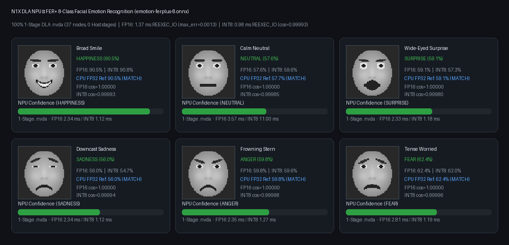

# N1X NPU Demos

## Super-Resolution (`./demo-superres`)

Executes the ONNX Model Zoo 3× sub-pixel CNN across overlapping 64×64 windows on the physical N1X DLA via `libcudla.so.1` and `libnvcudla.so`:

| Input → Output | DLA Windows | Time | Max Abs Error | RMSE |
| --- | --- | --- | --- | --- |
| 512×512 → 1536×1536 | 100 | `0.856 s` | `0.001584` | `0.000162` |
| 1024×1024 → 3072×3072 | 361 | `2.181 s` | `0.001539` | `0.000159` |

[1536×1536 DLA output](assets/astronaut-dla-3x.png) · [Asset provenance](assets/README.md) · [DnCNN denoising & ResNet-18 classification (`./demo-denoise`, `./demo-classify`)](vision.md)

### Setup and Run

After completing [setup](../docs/setup.md):

```sh
make runtime cudla
./demo-superres demo/assets/astronaut-input.png --output-dir results/my-superres-run
```

## Heterogeneous ONNX Execution Provider demo (`./demo-onnx`)

[`./demo-onnx`](../demo-onnx) ([`demo/ort_demo.py`](ort_demo.py)) compiles, partitions, caches, and executes ONNX Model Zoo graphs through [`N1xInferenceSession`](../runtime/n1x_ort.py) in `FP16` and auto-calibrated `INT8`, writing `result.json` and `report.html`:

Its repeatability check compares two NPU executions. It reports reference
accuracy separately, without a numerical acceptance threshold; identical
repeated outputs do not establish correct inference. The JSON and HTML reports
make this distinction explicit.

<p><a href="assets/emotion-ferplus-gallery-dla.png"></a></p>

[FER+ gallery artifact](assets/emotion-ferplus-gallery-dla.png) · [Asset provenance](assets/README.md#fer-facial-emotion-recognition-example-demo-onnx---model-emotion)

| Model (`--model`) | Stages (`DLA` / `Host`) | Precision | `.nvda` Size | Initial `EXEC` | Retained `REEXEC_IO` | Accuracy vs. FP32 Reference |
| --- | --- | --- | --- | --- | --- | --- |
| `emotion` (`emotion-ferplus-8.onnx`) | `1 DLA` / `0 Host` (37 nodes) | `FP16` | `21.21 MB` | `4.07 ms` | `1.37 ms` | `max_err = 0.001340`, `RMSE = 0.000811` (`6/6` top-1) |
| `emotion` (`emotion-ferplus-8.onnx`) | `1 DLA` / `0 Host` (37 nodes) | `INT8` | `12.47 MB` | `2.11 ms` | `0.98 ms` | `cos = 0.999930`, `RMSE = 0.031666` (`6/6` top-1) |
| `mnist` (`mnist-12.onnx`) | `1 DLA` / `0 Host` (7 nodes) | `FP16` / `INT8` | `2.98 MB` | `0.83 ms` | `0.33 ms` | `FP16 max_err = 0.005589`, `INT8 cos = 0.999853` |
| `superres` (`super-resolution-10.onnx`) | `1 DLA` / `1 Host` (`DepthToSpace`) | `FP16` | `3.19 MB` | `1.36 ms` | `1.04 ms` | `max_err = 0.001510`, `RMSE = 0.000244` |

These are earlier measurements, not a qualification of every later driver or
compiler bundle. A 13 November 2026 kernel31 lifecycle run returned repeatable
MNIST outputs with poor reference agreement (`max_err=11.54`, `RMSE=5.67`,
cosine `-0.182`). That result is **not numerically qualified**; no matching
pre-PM MNIST baseline was recorded, so it cannot be attributed to resume.
The separate `scripts/qualify_cudla.py --reuse` suite passed eight exact
independent reference comparisons before and after the DSP/AFE reloads and
device-only PM. Those pinned small graphs do not qualify the generic MNIST
compiler/runtime path; its discrepancy remains under investigation.

```sh
./demo-onnx --model emotion --precision fp16 --output-dir results/emotion-ferplus-fp16
./demo-onnx --model emotion --precision int8 --output-dir results/emotion-ferplus-int8
./demo-onnx --model mnist --precision fp16 --output-dir results/mnist-fp16
./demo-onnx --model mnist --precision int8 --output-dir results/mnist-int8
./demo-onnx --model superres --precision fp16 --output-dir results/superres-ort-fp16
```
