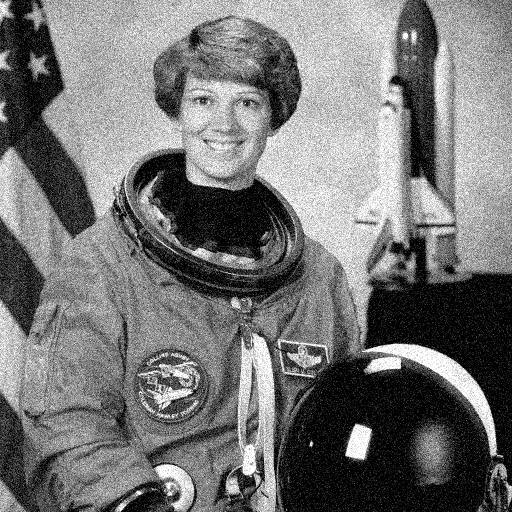
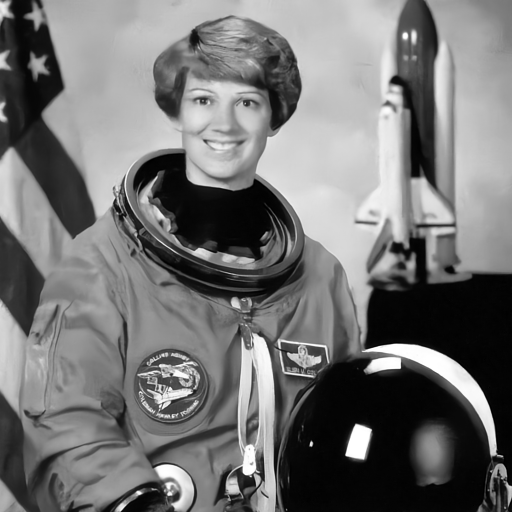

# Denoising and Image Classification (`./demo-denoise`, `./demo-classify`)

Executes KAIR's 17-convolution `DnCNN-25` denoiser and torchvision's 20-convolution `ResNet-18` classifier on the N1X NPU via `libcudla.so.1` and `libnvcudla.so`:

| Noisy Grayscale Input (`PSNR 20.73 dB`) | N1X DLA Denoised Output (`PSNR 31.83 dB`) |
| --- | --- |
|  |  |

- **DnCNN-25 (`./demo-denoise`)**: 17 convolutions across 3 NPU partitions (`6 + 6 + 5`), 64 overlapping 96×96 windows (`192` NPU submissions/image); `PSNR 20.73 -> 31.83 dB`, `SSIM 0.328 -> 0.847`, `RMSE 0.000175`.
- **ResNet-18 (`./demo-classify`)**: 20 convolutions across 12 NPU partitions (`27` NPU submissions/image on a 224×224 crop); top-1 Samoyed (`88.4%`), `RMSE <= 0.003637` vs. FP32 reference.

## Build and Run

After completing [setup](../docs/setup.md):

```sh
venv/bin/python scripts/prepare_vision.py --fetch
venv/bin/python scripts/test_vision_examples.py
make runtime cudla
```

Run denoising or classification:

```sh
./demo-denoise demo/assets/astronaut-input.png --add-noise --output-dir results/my-denoise
./demo-classify sources/vision/dog.jpg --output-dir results/my-classification
```

Checkpoints and model hashes are pinned in [`config/vision-models.json`](../config/vision-models.json); see [NOTICE](../NOTICE) for upstream model licenses.
