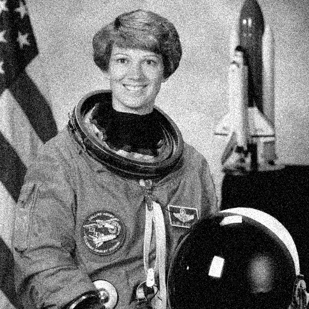
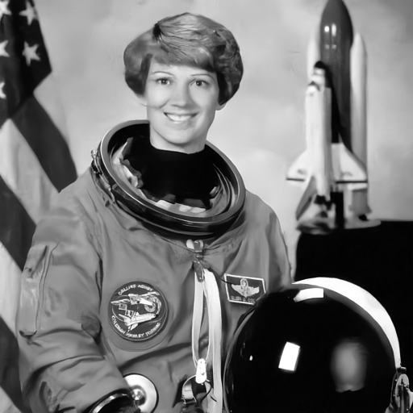

# Denoising and image classification

Two additional examples use the original NVIDIA Linux cuDLA frontend and this
project's N1X backend. Learned convolutions run on the physical NPU, with no
CPU fallback. Each example independently checks its result with ONNX Runtime
on the CPU. Both require the same audited P16, BIOS, kernel, firmware startup
and healthy driver as the [super-resolution example](README.md).

## Physical results

Both examples passed the independent FP32 reference on this P16. Denoising
restored the complete 512x512 NASA sample after reproducible synthetic noise:
PSNR rose from 20.73 to 31.83 dB and SSIM from 0.328 to 0.847. The dog image's
ResNet top-1 class was Samoyed (88.4% model score), matching the CPU reference.
Two-image batches for both applications added no retained allocations after
the first image. See the [hardware receipt](../docs/evidence/vision-hardware-2026-10-29.json).

| Noisy grayscale input | Actual NPU restoration |
| --- | --- |
|  |  |

These are full measured images, copied without re-encoding. Timing in each
batch image's report includes NPU submissions, CUDA staging and host graph
operations, but excludes initial model/device setup, image preprocessing,
output encoding and independent CPU validation. Single-image measurements from
the earlier qualification included initial device/model setup. They must not be
compared as equivalent benchmark measurements.

## Models and execution

**Denoising:** KAIR's trained `dncnn_25.pth`, a 17-convolution grayscale DnCNN
for additive Gaussian noise with sigma 25/255. Its published checkpoint already
has BatchNormalization merged into the convolutions. All convolutions and
their internal ReLUs run on NPU in three partitions (6 + 6 + 5 convolutions).
The CPU subtracts predicted noise from the image. Full images use overlapping
96x96 windows and a 17-pixel halo, preserving actual image edges. Output retains
the entire input size; the windows are not the user-visible result.

**Classification:** torchvision's ImageNet-trained ResNet-18 checkpoint
`resnet18-f37072fd.pth`, 1,000 classes. Preprocessing uses RGB, bilinear short-edge
resize to 256, a 224x224 center crop and ImageNet normalization. All 20 learned
convolutions run on NPU in 12 partitions. BatchNormalization is folded offline;
the independent reference retains the original normalization layers. CPU work
handles im2col gathering for stride-2 convolutions, max/average pooling,
residual additions/ReLUs, the final fully connected classifier and softmax.
The initial convolution's pointwise equivalent uses sixteen 28x28 windows over
its complete 112x112 feature map to keep retained memory bounded. This does not
reduce the classifier input resolution or change its convolution weights.

These are intentionally mixed CPU/NPU pipelines, not arbitrary ONNX import,
NPU training, or claims of an end-to-end NPU speedup. Compilation and validation
are specific to the pinned models and shapes. See
[current support](../docs/status.md) and [the cuDLA backend](../docs/cudla-backend.md).

## Acquire and build

First follow [setup](../docs/setup.md) for the pinned vendor inputs, analysis
environment, baseline loadables and runtime build. The Windows backend emulator
initialization also needs the baseline ReLU capture produced by
`venv/bin/python scripts/build_models.py` in a fresh workspace.

Then, from the repository root:

```sh
uv venv --python 3.12 sources/vision-venv
uv pip install --python sources/vision-venv/bin/python --require-hashes \
  --only-binary :all: -r requirements-vision.lock
sources/vision-venv/bin/python scripts/prepare_vision.py --fetch
sources/vision-venv/bin/python scripts/test_vision_examples.py
venv/bin/python scripts/build_vision_models.py
make runtime cudla
pkexec /usr/bin/python3 "$PWD/scripts/install_cudla_broker.py" --models all
```

PyTorch is used only for safe `weights_only=True` checkpoint acquisition and
offline verification. It does not provide the physical example's inference.
The preparation step creates numeric NPZ weights, fixed partition descriptions
and independent ONNX references under ignored `sources/vision/`. All original
downloads and prepared artifacts are checked against
[the committed manifest](../config/vision-models.json).
Generated loadables remain under ignored `results/`. The compiler builder
refuses existing partition directories to preserve earlier evidence; use a
fresh workspace for rebuilding. `--example denoise` or `--example classify`
builds only the selected example.

All 15 partition loadables were reproduced in a fresh source export with the
same hashes as the physical tests. The existing super-resolution loadable also
remained identical. See the [offline reproduction receipt](../docs/evidence/vision-reproduction-2026-10-29.json).

The offline tests compare the ResNet reference against direct PyTorch execution
of the original checkpoint, check the folded/partitioned graph and FP16 boundary
simulation, verify im2col and pooling, and compare DnCNN tiles against whole-image
inference at seams, corners and irregular dimensions. They do not access the NPU.

## Run on the NPU

After successful manual firmware startup, choose one example. For denoising:

```sh
./demo-denoise demo/assets/astronaut-input.png --add-noise \
  --output-dir results/my-denoise
```

For classification, start with a fresh, empty driver instance:

```sh
./demo-classify sources/vision/dog.jpg \
  --output-dir results/my-classification
```

These two commands cannot run back-to-back on the same instance: their combined
retained backing exceeds 64 MiB. Release completed allocations through the
documented [healthy manual shutdown](../docs/shutdown-reload.md#build-and-qualify),
then perform the [fresh startup](../docs/setup.md) before switching examples.
Batch several images in one invocation to avoid restarting between images.

The launchers and all image/ONNX processing remain unprivileged. Polkit starts
only the installed root-owned broker, which uses fixed installed model IDs and
a binary tensor protocol. Output directories must be new. The power profile is
only recorded, never changed. Re-run the installer after intentionally rebuilding
a pinned model or runtime; it refuses any model whose committed hash differs.

Pass several image paths in one invocation to reuse the same loaded models:

```sh
./demo-classify photo1.jpg photo2.jpg --output-dir results/my-classification-batch
```

Each image gets a numbered subdirectory, its own reference check and report.
The models and driver backing remain shared; later images must add zero retained
allocations. A failed image stops the batch. This is particularly useful for the
classifier, whose partitions require 65,777,664 bytes of the 64-MiB retained
budget. Denoising requires 25,817,088 bytes. Starting another process creates new
allocations; it does not reuse models from an exited process.

For denoising, `--add-noise` creates a reproducible test from a clean image
(sigma 25/255, NumPy seed 0), reports PSNR and SSIM against that original, and
saves the noisy image, exact numeric input and NPU restoration. Without this
flag, supply an already noisy image; no clean-reference quality score is claimed.
Both axes must be at least 96 pixels. This grayscale model does not remove
arbitrary real camera noise or restore color channels.

PSNR/SSIM use clipped floating-point images in [0,1], before PNG rounding.
SSIM uses an 11x11 Gaussian window (sigma 1.5), population variance and the
valid interior. The PNGs are clipped 8-bit renderings of those numeric results.

Classification writes `predictions.json` with five labels/probabilities and
checks its logits and top-1 choice against the independent CPU reference. The
image crop, raw numeric NPU-derived output, execution metadata, model hashes and
HTML report are retained alongside the result. Probabilities are ImageNet model
scores, not calibrated certainty about arbitrary images.

Numerical acceptance is fixed before execution: denoising noise predictions
must have max absolute error <= 0.01 and RMSE <= 0.001; classification logits
must have max absolute error <= 0.25 and RMSE <= 0.05, with matching top-1 class.
The synthetic denoising example must also improve PSNR. Quantization occurs at
each NPU partition boundary; the CPU reference uses original FP32 weights.

Each loaded partition retains one driver allocation, reused across its windows.
The demos check the complete required allocation budget before submitting work
and verify bounded growth afterwards. Current retained allocations can prevent
the next example from fitting; this is not an invitation to increase the driver
limits. Use the documented [healthy manual shutdown/start sequence](../docs/shutdown-reload.md)
to release completed allocations when necessary. The examples never reset,
unload or restart the driver automatically. After an uncertain firmware/DMA
failure, stop and preserve evidence; do not retry or force-unload.

## Upstream sources and licensing

- [KAIR DnCNN implementation](https://github.com/cszn/KAIR/blob/master/models/network_dncnn.py),
  [test/preprocessing](https://github.com/cszn/KAIR/blob/master/main_test_dncnn.py),
  [trained checkpoints](https://github.com/cszn/KAIR/releases/tag/v1.0),
  [MIT license](https://github.com/cszn/KAIR/blob/master/LICENSE).
- [torchvision ResNet implementation and checkpoint](https://github.com/pytorch/vision/blob/main/torchvision/models/resnet.py),
  [BSD-3-Clause license](https://github.com/pytorch/vision/blob/main/LICENSE),
  [ImageNet labels](https://github.com/pytorch/hub/blob/master/imagenet_classes.txt).

The optional demonstration input is the
[PyTorch Hub dog photograph](https://github.com/pytorch/hub/blob/master/images/dog.jpg),
downloaded locally with a pinned hash, not included in this repository.

Source checkpoints, derived weights and compiled vendor loadables are downloaded
or generated locally and are not redistributed in Git. See [NOTICE](../NOTICE).
