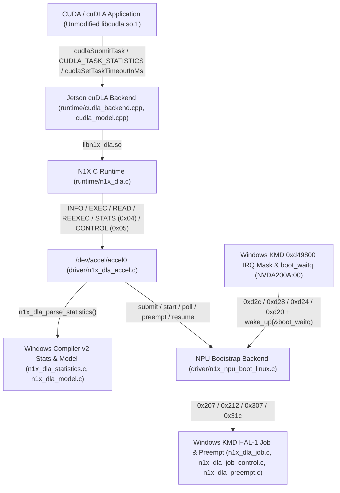

# N1X NPU Kernel Driver & `/dev/accel` UAPI Expansion (IRQ, Statistics, Preemption)

*   **Author:** johann
*   **Status:** Draft
*   **Date:** 2026-11-01

--------------------------------------------------------------------------------

## Overview

The Linux kernel driver for the NVIDIA N1X neural processing unit (`n1x_npu_bootstrap`) currently executes single-task FP16 inference graphs through `/dev/accel/accel0` and the user-space `cuDLA` backend (`libnvcudla.so`). However, three kernel-level capabilities that are already decoded in standalone C modules within `driver/` remain disconnected from the active Linux driver and user-space ABI:

1.  **Hardware Interrupt Completion**: The driver busy-polls MMIO registers at 1-millisecond intervals instead of sleeping on the platform ACPI interrupt declared for `NVDA200A:00`.
2.  **Hardware Layer Statistics & Profiling**: The driver initializes the 1 MiB Region 5 ring buffer and compiles `driver/n1x_dla_statistics.c`, but provides no `/dev/accel` interface to validate and read per-layer hardware profiling records.
3.  **Cooperative Task Preemption & Context Save/Restore**: The driver compiles `driver/n1x_dla_preempt.c` and `driver/n1x_dla_job_control.c` (method `0x212` preemption request and method `0x307` context restore), but `/dev/accel/accel0` only supports blocking, non-preemptible task execution.

This design specifies how to wire optional ACPI interrupt-driven completion, Region 5 / v2 statistics validation and export, and cooperative task preemption/resume into `driver/n1x_npu_boot_linux.c`, `driver/n1x_dla_accel.c`, `include/uapi/n1x_dla_accel.h`, and `runtime/n1x_dla.c` while preserving the existing fail-closed DMA and lifetime guarantees.

## The Problem

Today, every NPU task submission in `driver/n1x_npu_boot_linux.c` blocks the calling kernel thread in a polling loop (`5001` iterations with `usleep_range(1000, 1100)`), adding up to 1 millisecond of scheduling jitter per tile submission (for example, 192 submissions per image in `demo-denoise`). In addition, although the Windows KMD's v2 statistics layout (`0x00000300` / version `2`) and HAL-1 task preemption protocol (`0x212` / `0x120b` checkpoint save and `0x307` resume) have been reverse-engineered and verified in offline unit tests, neither capability is reachable from Linux user space:

*   `driver/Kbuild` compiles `n1x_dla_statistics.o`, `n1x_dla_preempt.o`, and `n1x_dla_job_control.o` only in `make kernel-check`, excluding them from `n1x_npu_bootstrap.ko`.
*   `include/uapi/n1x_dla_accel.h` exposes only `INFO`, `EXEC`, `READ`, and `REEXEC` ioctls, with no way to query validated layer statistics or issue non-blocking submit/poll/preempt/resume operations.
*   Enabling hardware interrupts or preemption without strict opt-in and fail-closed guards risks destabilizing the already-qualified synchronous execution path if the ACPI interrupt line behaves unexpectedly or if a preempted context is modified before resume.

## Goals

*   **Eliminate 1 ms polling latency using the Windows KMD IRQ mask contract**: Add an opt-in platform interrupt handler on `NVDA200A:00` (`enable_irq` module parameter, default `false` until physically qualified) that follows the exact `nvlddmkm.sys` (`0xd49800`) `owned`/`saved` mask state machine on registers `0xd2c`, `0xd28`, `0xd24`, and `0xd20` to wake `boot_waitq` on DLA mailbox/`SWGEN0` interrupts.
*   **Align v2 hardware statistics across Windows `nvdla_compiler.dll`, `/dev/accel`, and Jetson `cuDLA`**: Link `n1x_dla_statistics.o` and `n1x_dla_model.o` into `n1x_npu_bootstrap.ko`, expose `DRM_IOCTL_N1X_DLA_STATS` for kernel-validated v2 (`0x00000300`, version `2`) statistics, and wire `task-0-stats` into `runtime/cudla_model.cpp` and `runtime/cudla_backend.cpp` (`CUDLA_NUM_OUTPUT_TASK_STATISTICS`, `CUDLA_OUTPUT_TASK_STATISTICS_DESCRIPTORS`, and `CUDLA_TASK_STATISTICS` in `cudlaMemRegister` / `cudlaSubmitTask`).
*   **Align cooperative task preemption with Windows KMD (`nvlddmkm.sys`) & RV32 firmware**: Link `n1x_dla_preempt.o` and `n1x_dla_job_control.o` into `n1x_npu_bootstrap.ko`, issue the Windows KMD firmware preemption gate command (`0x31c` / command `28`, `data = 1` $\rightarrow$ `0x1c02`) when `enable_preempt=1`, and expose step-wise job control (`START`, `POLL`, `PREEMPT` via `0x212`/`0x120b`, `RESUME` via `0x307`) on `/dev/accel/accel0` and `runtime/n1x_dla.c`.
*   **Close remaining Jetson `cuDLA` (`libcudla.so.1`) runtime gaps**: Support `CUDLA_DEVICE_VERSION` in `cudlaDrvDeviceGetAttribute`, `cudlaDrvSetTaskTimeoutInMs` (`1..1000000` ms, default `30000` ms), `CUDLA_SUBMIT_NOOP`, and `CUDLA_SUBMIT_SKIP_LOCK_ACQUIRE` in `runtime/cudla_backend.cpp`.
*   **Preserve ABI v2 backward compatibility and fail-closed safety**: Existing `INFO`, `EXEC`, `READ`, and `REEXEC` callers (`cudla-smoke`, `n1x-dla-broker`, `demo-superres`, `demo-denoise`, `demo-classify`) must continue to work unmodified, and any ambiguous interrupt, preemption, or ACK error must poison the queue and retain DMA buffers until checked shutdown or reboot.

## Non-Goals

*   **Dynamic per-job DMA unmapping while powered**: Freeing SMMU mappings for individual completed or preempted jobs without powering down the NPU via HFRP `stop` is out of scope for this design.
*   **Zero-copy `DMA-BUF` / `NvSciBuf` / `NvSciSync` import**: Direct SMMU mapping of external GPU or `NvSci` objects is out of scope (hybrid CUDA mode remains the supported `cuDLA` execution mode).
*   **Live hardware engine reset after a hung task**: Executing the Windows KMD hardware reset sequence on physical silicon after a timeout remains out of scope; failed or timed-out jobs continue to fail closed.
*   **Offline compiler changes for new neural network operators (`PDP`, `SDP` Ewise, INT8)**: Expanding the offline TensorRT loadable translator is a separate effort.

## Open Questions

*   **Question 1 (ACPI IRQ Masking Semantics on Physical P16)**: On physical P16 hardware, register `0xd28` (mask) retains bit 24 (`0x01000000`) even after masking `owned` bits via `0xd24`. Does registering a Linux IRQ handler with `devm_request_irq()` require filtering the ISR on `(pending & 0xc0)` while using the `nvlddmkm.sys` `0xd49800` `owned`/`saved` mask transitions on `0xd24`/`0xd20`?
*   **Question 2 (Preemption Enable Command at Startup)**: The Windows KMD sends control command `(28, 1)` (`0x31c`, `data = 1`, expecting `0x1c02`) while idle to set firmware `ENABLE = 1` (`0x183728`) before submitting preemptible tasks. Should `n1x_npu_bootstrap` send `0x31c` during `start` only when `enable_preempt=1` is passed, so default startup traffic on `NVDA200A:00` remains bit-for-bit identical?

## Critical User Journeys (CUJs)

### CUJ 1: Low-Latency Tile Inference with Interrupt-Driven Completion

*   **Given**: `n1x_npu_bootstrap.ko` is loaded with `enable_irq=1` and initialized via `/sys/bus/platform/devices/NVDA200A:00/start`, and `/dev/accel/accel0` is open.
*   **When**: A user-space client (`n1x-dla-broker`) submits 100 super-resolution tiles or 192 denoising windows through `EXEC` and `REEXEC`.
*   **Then**: Instead of sleeping in 1 ms `usleep_range` increments, the kernel thread unmasks `saved | 0xc0` at `0xd20`, sleeps on `boot_waitq`, and wakes immediately when the `NVDA200A:00` interrupt handler observes `pending & 0xc0` and masks `current & owned` at `0xd24` per the Windows KMD `0xd49800` contract.

### CUJ 2: Inspecting Per-Layer Hardware Statistics via Standard Jetson `cuDLA` and `/dev/accel`

*   **Given**: A compiled `NVDA` loadable containing a `task-0-stats` v2 statistics blob (`0x00000300`, version `2`) loaded through NVIDIA's unmodified `libcudla.so.1` into `libnvcudla.so` (or submitted directly via `/dev/accel/accel0`).
*   **When**: A `cuDLA` application queries `cudlaModuleGetAttributes(..., CUDLA_NUM_OUTPUT_TASK_STATISTICS, ...)` and `CUDLA_OUTPUT_TASK_STATISTICS_DESCRIPTORS`, registers a CUDA buffer with `cudlaMemRegister(..., CUDLA_TASK_STATISTICS)`, and calls `cudlaSubmitTask()` with the statistics buffer appended to `outputTensor` (or calls `DRM_IOCTL_N1X_DLA_STATS` + `DRM_IOCTL_N1X_DLA_READ` directly).
*   **Then**: The kernel validates the v2 statistics header and per-record offsets via `n1x_dla_parse_statistics()`, and `libnvcudla.so` copies the completed per-layer profiling buffer back to the caller's registered CUDA statistics buffer.

### CUJ 3: Cooperative Preemption and Resume of a Long-Running Resumable Task

*   **Given**: `n1x_npu_bootstrap.ko` is loaded with `enable_preempt=1` (which enables firmware preemption gate `0x183728` via method `0x31c` / response `0x1c02`), and a client submits a context-enabled v2 task (`flags` with `N1X_DLA_EXEC_RESUMABLE`).
*   **When**: The client issues `DRM_IOCTL_N1X_DLA_CONTROL` (`N1X_DLA_CONTROL_PREEMPT`) while the task is running, inspects the resulting `N1X_DLA_PREEMPT_CHECKPOINT` outcome, and then issues `N1X_DLA_CONTROL_RESUME` followed by `N1X_DLA_CONTROL_POLL`.
*   **Then**: The kernel executes `n1x_dla_job_preempt()` (Windows KMD `0xdd7640` 32-byte preemption descriptor with 27-byte dual-fence postactions on method `0x212`, verifying `0x120b` and checkpoint marker `1`) and `n1x_dla_job_resume()` (method `0x307`), and the resumed task completes with the exact expected output tensor and task fence.

--------------------------------------------------------------------------------

## Technical Plan (Architecture)

### 1. System Architecture & Data Flow

The architecture aligns the Linux stack with both the **Microsoft Windows KMD/UMD (`nvlddmkm.sys`, `nvdla_runtime.dll`, `nvdla_compiler.dll`)** hardware protocols and the **NVIDIA Jetson `cuDLA` (`libcudla.so.1` / `cudla.h`)** user-space runtime interface:



### 2. Interrupt-Driven Wakeup Aligned with Windows KMD (`0xd49800`)

1.  **Windows KMD Mask State Machine (`scripts/emulate_irq_mask.py`)**:
    *   In `nvlddmkm.sys` (`0xd43c48` and `0xd49800`), the KMD captures `owned = read(0xd2c)` at boot (`boot_ping.owned`), maintains a cached `saved` mask word (`CTX+0x49c`), masks interrupts by reading `current = read(0xd28)`, computing `value = current & owned`, updating `saved = value ? value : saved`, and writing `value` to `0xd24`, and unmasks interrupts by updating `saved |= 0xc0` and writing `saved` to `0xd20`.
    *   `driver/n1x_npu_boot_linux.c` adds `static bool enable_irq;` (`module_param(enable_irq, bool, 0444)`, default `false`), `DECLARE_WAIT_QUEUE_HEAD(boot_waitq)`, `spinlock_t boot_irq_lock`, and `atomic_t boot_irq_seq`.
    *   When `enable_irq` is true and `platform_get_irq_optional(pdev, 0) > 0`, `n1x_boot_probe()` registers `n1x_boot_irq_handler` via `devm_request_irq()`.
2.  **Top-Half Handler (`n1x_boot_irq_handler`)**:
    *   Reads logical status register `0x8` (`pending = readl(boot_dla->base + 0x8)`). If `(pending & 0xc0U) == 0`, returns `IRQ_NONE` (ignoring unowned status bits and bit 24 in `0xd28`).
    *   Under `boot_irq_lock`, executes the `nvlddmkm.sys` `0xd49800` disable sequence (`current = readl(0xd28)`, `value = current & owned`, `if (value) saved = value`, `writel(value, 0xd24)`), increments `boot_irq_seq`, wakes `boot_waitq`, and returns `IRQ_HANDLED`.
3.  **Waitqueue Integration in `n1x_boot_delay()`**:
    *   When `boot_dla->irq_enabled` is active, `n1x_boot_delay()` executes the `nvlddmkm.sys` `0xd49800` enable sequence (`saved |= 0xc0U`, `writel(saved, 0xd20)`) under `boot_irq_lock`, then calls `wait_event_timeout(boot_waitq, atomic_read(&boot_irq_seq) != seq || (readl(boot_dla->base + 0x8) & 0xc0U) != 0, usecs_to_jiffies(us))`.
    *   During `shutdown`, the existing `irq-mask` stage already masks `irq_mask_before & irq_owned` at `0xd24` before `HFRP` `stop`.

### 3. Validated v2 Layer Statistics Across Kernel and Jetson `cuDLA`

1.  **Kernel Validation (`driver/Kbuild`, `include/uapi/n1x_dla_accel.h`, `driver/n1x_dla_accel.c`)**:
    *   Link `n1x_dla_statistics.o` and `n1x_dla_model.o` into `n1x_npu_bootstrap-y` in `driver/Kbuild`.
    *   Add capability bit `N1X_DLA_CAP_STATISTICS (1U << 4)` (`16U`) and `DRM_IOCTL_N1X_DLA_STATS` (`0x04`):
        ```c
        struct n1x_dla_accel_stats {
            __u64 job_id;
            __u64 offset;
            __u64 bytes;
            __u32 count;
            __u32 metadata_offset;
            __u32 metadata_stride;
            __u32 data_offset;
            __u32 data_stride;
            __u32 reserved;
        };
        ```
    *   `stats_ioctl()` validates the caller-owned completed job's statistics slice via `n1x_dla_parse_statistics()` (`0x00000300`, version `2`, `metadata_stride == 6144`, `data_stride == 1024`, 64-byte aligned `data_offset`, and per-record `+0x1108` offset invariants from `nvdla_compiler.dll` `0xc76488`).
2.  **Jetson `cuDLA` (`runtime/cudla_model.cpp`, `runtime/cudla_backend.cpp`)**:
    *   In `runtime/cudla_model.cpp`, match the Windows `nvdla_runtime.dll` content regex `^task-?(\d+)-stat(s|_list)$` (`task-0-stats`) during loadable deserialization. Because `nvdla_compiler.dll` emits v2 statistics (`version == 2`) that the older Windows `nvdla_runtime.dll` rejected with status `2`, `n1x::Model` validates `task-0-stats` using the v2 header layout and records the statistics descriptor (`cudlaModuleTensorDescriptor` with `name = "task-0-stats"`, `size = b.bytes`, and its materialized memory `offset`).
    *   In `runtime/cudla_backend.cpp`:
        *   `cudlaDrvModuleGetAttributes` implements `CUDLA_NUM_OUTPUT_TASK_STATISTICS` (`m->model.statistics.size()`) and `CUDLA_OUTPUT_TASK_STATISTICS_DESCRIPTORS` (copying `m->model.statistics[i].desc`).
        *   `cudlaDrvMemRegister` accepts `flags == 0` or `flags == CUDLA_TASK_STATISTICS`, recording whether a registration was tagged for statistics.
        *   `cudlaDrvSubmitTask` accepts `tasks->numOutputTensors == m->model.outputs.size()` (standard) or `m->model.outputs.size() + m->model.statistics.size()` (profiling enabled per `cudla.h` lines 930-938). When profiling is enabled, after job completion `cudlaDrvSubmitTask` validates the statistics region via `n1x_dla_stats()` (`DRM_IOCTL_N1X_DLA_STATS`), reads the statistics bytes via `n1x_dla_read()`, and copies them to the caller's registered CUDA statistics buffer via `cuMemcpyHtoDAsync`.

### 4. Cooperative Task Preemption & Jetson `cuDLA` Runtime Parity

1.  **Windows KMD Preemption Gate & Protocol (`driver/n1x_npu_boot_linux.c`, `driver/n1x_dla_job_control.c`)**:
    *   Link `n1x_dla_preempt.o` and `n1x_dla_job_control.o` into `n1x_npu_bootstrap-y`.
    *   Add `static bool enable_preempt;` (`module_param(enable_preempt, bool, 0444)`, default `false`).
    *   Per `scripts/test_profile1_preemption.py`, when `enable_preempt=1` is set, startup (after `apply_lpwr` and before `bypass_task`) sends the Windows KMD firmware preemption gate method `0x31c` (`0x300 | 28`, `data = 1`) and verifies response `0x1c02` (`data = 1`), setting firmware `ENABLE = 1` (`0x183728`).
    *   Expose `N1X_DLA_CAP_PREEMPT (1U << 5)` (`32U`) and `DRM_IOCTL_N1X_DLA_CONTROL` (`0x05`) supporting `N1X_DLA_CONTROL_START`, `N1X_DLA_CONTROL_POLL`, `N1X_DLA_CONTROL_PREEMPT`, and `N1X_DLA_CONTROL_RESUME` backed by `n1x_dla_job_start()`, `n1x_dla_job_poll()`, `n1x_dla_job_preempt()` (method `0x212` with the 32-byte header and 27-byte dual-fence postaction stream from `nvlddmkm.sys` `0xdd7640`), and `n1x_dla_job_resume()` (method `0x307`).
2.  **Jetson `cuDLA` Device & Submission Parity (`runtime/cudla_backend.cpp`)**:
    *   `cudlaDrvDeviceGetAttribute`: Support `CUDLA_DEVICE_VERSION` (`out->deviceVersion = 0x0200U`, matching Orin/v2 DLA class).
    *   `cudlaDrvSetTaskTimeoutInMs`: Validate `timeout > 0 && timeout <= 1000000` (returning `cudlaErrorInvalidParam` for `0` or `> 1000000` per `cudla.h` lines 1335-1337) and store `d->timeout_ms` (default `30000` ms).
    *   `cudlaDrvSubmitTask`: Support `CUDLA_SUBMIT_NOOP` (returning `cudlaSuccess` after validating all task/tensor/stream parameters without executing on hardware, per `cudla.h` lines 969-974) and `CUDLA_SUBMIT_SKIP_LOCK_ACQUIRE`.

--------------------------------------------------------------------------------

## Alternatives Considered

### Alternative 1: Invent a Custom Linux-Only IRQ Masking Rule Instead of Following Windows KMD (`0xd49800`)

*   **Description**: Hardcode `0xc0` writes directly to `0xd24` and `0xd20` without consulting the hardware route register `0xd2c` or preserving `saved = current & owned` as `nvlddmkm.sys` (`0xd49800`) does.
*   **Pros**:
    *   Slightly fewer lines of code in the interrupt handler.
*   **Cons**:
    *   Diverges from the reverse-engineered and Unicorn-verified Windows KMD routine (`scripts/emulate_irq_mask.py`), which initializes `owned = read(0xd2c)`, masks `read(0xd28) & owned` at `0xd24`, and unmasks `saved | 0xc0` at `0xd20`.
*   **Reason for Rejection**: Following the exact `nvlddmkm.sys` `0xd49800` `owned`/`saved` state machine guarantees register-level parity with the Microsoft Windows driver while already coexisting with the existing `ping` and `shutdown` `irq-mask` stages.

### Alternative 2: Expose Layerwise Statistics Only via Custom `/dev/accel` Ioctls Without Wiring Jetson `cuDLA`

*   **Description**: Add `DRM_IOCTL_N1X_DLA_STATS` to `/dev/accel/accel0` and `libn1x_dla.so`, but leave `CUDLA_NUM_OUTPUT_TASK_STATISTICS` hardcoded to `0` and `CUDLA_TASK_STATISTICS` unsupported in `runtime/cudla_backend.cpp`.
*   **Pros**:
    *   Smaller diff in `runtime/cudla_model.cpp` and `runtime/cudla_backend.cpp`.
*   **Cons**:
    *   Breaks parity with Jetson `cuDLA` (`cudla.h`), where profiling consumers discover statistics buffers via `CUDLA_NUM_OUTPUT_TASK_STATISTICS` / `CUDLA_OUTPUT_TASK_STATISTICS_DESCRIPTORS`, register CUDA memory with `CUDLA_TASK_STATISTICS`, and append statistics buffers to `cudlaTask::outputTensor`.
*   **Reason for Rejection**: Wiring `task-0-stats` in `runtime/cudla_model.cpp` and `runtime/cudla_backend.cpp` on top of `DRM_IOCTL_N1X_DLA_STATS` aligns both the kernel validation contract (`nvdla_compiler.dll` v2 format) and the user-space Jetson `cuDLA` ABI.

### Alternative 3: Multi-Queue Automatic Kernel Scheduler Instead of Explicit HAL-1 Preemption (`0x212` / `0x307`)

*   **Description**: Hide preemption behind blocking `DRM_IOCTL_N1X_DLA_EXEC` calls by automatically issuing `0x212` inside the kernel whenever a second process calls `EXEC`.
*   **Pros**:
    *   Requires no new job control ioctl.
*   **Cons**:
    *   Only context-enabled v2 tasks (`flags = 1`, `context_addr != 0`) with firmware preemption enabled via `0x31c` (`(28, 1)`) can be preempted; standard tasks cannot.
    *   Obscures the Windows KMD (`0xdd7640`) checkpoint (`N1X_DLA_PREEMPT_CHECKPOINT`) vs. task-fence (`N1X_DLA_PREEMPT_TASK_FENCE`) distinction needed by a WDDM/MCDM-style scheduler or user-space broker.
*   **Reason for Rejection**: Exposing the Windows KMD HAL-1 lifecycle (`START`, `POLL`, `PREEMPT`, `RESUME`) directly via `DRM_IOCTL_N1X_DLA_CONTROL` preserves exact protocol fidelity with `nvlddmkm.sys` and `driver/n1x_dla_job_control.c`.

--------------------------------------------------------------------------------

## Non-Functional Requirements

*   **Microsoft & Jetson Protocol Parity**:
    *   IRQ masking/unmasking must match `nvlddmkm.sys` `0xd49800` (`scripts/emulate_irq_mask.py`).
    *   Preemption enable (`0x31c`), preemption request (`0x212` with 27-byte dual-fence postactions), and context restore (`0x307`) must match `nvlddmkm.sys` and `dla-profile1-verified.bin` (`scripts/test_profile1_preemption.py`, `scripts/inspect_kmd_preemption_request.py`).
    *   Statistics validation must match `nvdla_compiler.dll` `0xc76488` v2 layout (`scripts/test_statistics_v2.py`), and `libnvcudla.so` must conform to NVIDIA's `cudla.h` v1.5.0 contract for `CUDLA_TASK_STATISTICS`, `CUDLA_NUM_OUTPUT_TASK_STATISTICS`, `CUDLA_OUTPUT_TASK_STATISTICS_DESCRIPTORS`, `CUDLA_DEVICE_VERSION`, `cudlaSetTaskTimeoutInMs`, `CUDLA_SUBMIT_NOOP`, and `CUDLA_SUBMIT_SKIP_LOCK_ACQUIRE`.
*   **Latency & CPU Overhead**: When `enable_irq=1` is enabled, task completion wakeup latency must be driven by the hardware interrupt rather than the 1 ms `usleep_range(1000, 1100)` polling floor, while maintaining a hard upper bound of `5001` iterations ($\approx 5\text{ s}$) so a missing interrupt never hangs an unkillable kernel thread.
*   **DMA & Memory Safety (Fail-Closed)**:
    *   No DMA buffer (`dma_alloc_coherent` + IOMMU domain mapping) for an active (`RUNNING`) or preempted (`SUSPENDED`) job may ever be unmapped or freed while the NPU remains powered (`boot_started == true`) unless the job reaches a verified terminal completion fence (`N1X_DLA_JOB_COMPLETED` or `N1X_DLA_PREEMPT_TASK_FENCE`).
    *   Any timeout, unexpected mailbox status, failed preemption (`N1X_DLA_PREEMPT_FAILED`), or file-descriptor closure on an incomplete job must set `accel->poisoned = true` and `slot->retained = true`, blocking further submissions until a clean `shutdown` (`HFRP` `0x05` stop) or reboot.
*   **Backward Compatibility**:
    *   `N1X_DLA_ABI_VERSION` remains `2`.
    *   With default module parameters (`enable_irq=0`, `enable_preempt=0`), MMIO register traffic during `start`, `EXEC`, `REEXEC`, and `shutdown` must remain identical to the qualified baseline.
*   **Observability**:
    *   `/sys/bus/platform/devices/NVDA200A:00/status` must report IRQ registration/wakeup counters (`irq_enabled`, `irq_count`) and preemption gate status (`preempt_enabled`, `preempt_accepted`) so live hardware tests can verify both subsystems.

--------------------------------------------------------------------------------

## Detailed Implementation Plan

### Phase 1: Kernel Module Linkage & `/dev/accel` UAPI Expansion

1.  **`driver/Kbuild`** *(Modify)*:
    *   **Rationale**: Link the already-verified protocol objects (`n1x_dla_statistics.o`, `n1x_dla_preempt.o`, `n1x_dla_job_control.o`, and `n1x_dla_model.o`) into `n1x_npu_bootstrap-y` so they are compiled into `n1x_npu_bootstrap.ko` in addition to `make kernel-check`.
2.  **`include/uapi/n1x_dla_accel.h`** *(Modify)*:
    *   **Rationale**: Extend the user-space ABI header with new capability flags and ioctl payloads while preserving `N1X_DLA_ABI_VERSION` (`2`) and existing struct layouts:
        *   Add `N1X_DLA_CAP_STATISTICS (1U << 4)` (`16U`) and `N1X_DLA_CAP_PREEMPT (1U << 5)` (`32U`).
        *   Add `N1X_DLA_EXEC_RESUMABLE (1U << 0)` flag for context-enabled v2 task descriptors.
        *   Define `struct n1x_dla_accel_stats` and `DRM_IOCTL_N1X_DLA_STATS` (`0x04`).
        *   Define `struct n1x_dla_accel_control` (`N1X_DLA_CONTROL_START`, `N1X_DLA_CONTROL_POLL`, `N1X_DLA_CONTROL_PREEMPT`, `N1X_DLA_CONTROL_RESUME`) and `DRM_IOCTL_N1X_DLA_CONTROL` (`0x05`).
3.  **`include/n1x_dla_accel.h` & `driver/n1x_dla_accel.c`** *(Modify)*:
    *   **Rationale**: Wire the new `STATS` and `CONTROL` ioctls into `/dev/accel/accel0`:
        *   Extend `struct n1x_dla_accel` registration to accept optional job control callbacks (`start`, `poll`, `preempt`, `resume`, plus capability query) alongside the existing synchronous `submit` callback.
        *   Implement `stats_ioctl()` to validate caller-owned completed job regions via `n1x_dla_parse_statistics()` and return the validated v2 layout metadata.
        *   Implement `control_ioctl()` to manage step-wise `START`, `POLL`, `PREEMPT`, and `RESUME` transitions on a caller-owned DMA slot, enforcing single-active-job serialization and fail-closed DMA retention (`accel->poisoned = true`, `slot->retained = true`) if a running or suspended job fails or its file descriptor closes early.

### Phase 2: Windows KMD IRQ Masking (`0xd49800`) & Preemption Gate (`0x31c`) in Bootstrap Driver

4.  **`driver/n1x_npu_boot_linux.c`** *(Modify)*:
    *   **Rationale**: Connect `NVDA200A:00` hardware interrupts and HAL-1 preemption to the platform driver:
        *   Add opt-in `enable_irq` (default `false`) and `enable_preempt` (default `false`) module parameters.
        *   Implement `n1x_boot_irq_handler()` and `n1x_boot_delay()` using the `nvlddmkm.sys` (`0xd49800`) `owned` (`0xd2c`) / `saved` (`0xd28`) mask state machine on `0xd24` (mask) and `0xd20` (unmask `saved | 0xc0`), waking `boot_waitq` when `(readl(0x8) & 0xc0U) != 0`.
        *   When `enable_preempt=1`, send the Windows KMD idle preemption-enable command `(28, 1)` (`0x31c` $\rightarrow$ `0x1c02`) during startup after `apply_lpwr`, and wire backend callbacks (`n1x_boot_accel_start`, `n1x_boot_accel_poll`, `n1x_boot_accel_preempt`, `n1x_boot_accel_resume`) to `n1x_dla_job_start()`, `n1x_dla_job_poll()`, `n1x_dla_job_preempt()`, and `n1x_dla_job_resume()`.
        *   Append `irq_enabled`, `irq_count`, `preempt_enabled`, and `preempt_accepted` fields to `/sys/bus/platform/devices/NVDA200A:00/status`.

### Phase 3: C Runtime & Jetson `cuDLA` (`libnvcudla.so`) Alignment

5.  **`runtime/n1x_dla.h`, `runtime/n1x_dla.c`, & `runtime/n1x_dla.py`** *(Modify)*:
    *   **Rationale**: Expose `n1x_dla_stats()` (`DRM_IOCTL_N1X_DLA_STATS`) and `n1x_dla_control()` (`DRM_IOCTL_N1X_DLA_CONTROL`) in `libn1x_dla.so` and the Python runtime wrapper.
6.  **`runtime/cudla_model.hpp` & `runtime/cudla_model.cpp`** *(Modify)*:
    *   **Rationale**: Align loadable deserialization with `nvdla_runtime.dll` and `nvdla_compiler.dll` by matching the `^task-?(\d+)-stat(s|_list)$` (`task-0-stats`) content blob, validating its v2 statistics header (`0x00000300`, version `2`), and populating `Model::statistics` (`std::vector<Tensor>`) with the corresponding `cudlaModuleTensorDescriptor` and materialized image offset.
7.  **`runtime/cudla_backend.cpp`** *(Modify)*:
    *   **Rationale**: Align `libnvcudla.so` with NVIDIA's Jetson `cudla.h` v1.5.0 contract:
        *   Support `CUDLA_NUM_OUTPUT_TASK_STATISTICS` and `CUDLA_OUTPUT_TASK_STATISTICS_DESCRIPTORS` in `cudlaDrvModuleGetAttributes`.
        *   Support `CUDLA_TASK_STATISTICS` in `cudlaDrvMemRegister`.
        *   Support optional statistics output buffers in `cudlaDrvSubmitTask` (validating via `n1x_dla_stats()`, reading via `n1x_dla_read()`, and copying to the registered CUDA buffer), as well as `CUDLA_SUBMIT_NOOP` and `CUDLA_SUBMIT_SKIP_LOCK_ACQUIRE`.
        *   Support `CUDLA_DEVICE_VERSION` (`0x0200U`) in `cudlaDrvDeviceGetAttribute` and `cudlaDrvSetTaskTimeoutInMs` (`1..1000000` ms, default `30000` ms).

### Phase 4: Verification Plan

8.  **Offline Unit & Differential Test Suites (`scripts/`)** *(Modify)*:
    *   **`scripts/test_dla_runtime.py`**: Verify `n1x_dla_stats()` and `n1x_dla_control()` ABI layout, ioctl dispatch, and error handling.
    *   **`scripts/test_linux_accel.py` & `scripts/test_linux_accel_backend.py`**: Exercise `DRM_IOCTL_N1X_DLA_STATS` (valid v2 buffer vs. malformed/out-of-bounds rejection) and `DRM_IOCTL_N1X_DLA_CONTROL` (`START` $\rightarrow$ `PREEMPT` checkpoint vs. task-fence $\rightarrow$ `RESUME` $\rightarrow$ `POLL` completion, plus early close fail-closed retention).
    *   **`scripts/test_linux_bootstrap.py`**: Verify `enable_irq=1` (`0xd49800` `owned`/`saved` mask transitions and `boot_waitq` wakeup) and `enable_preempt=1` (`0x31c` $\rightarrow$ `0x1c02` startup gate).
    *   **`scripts/test_cudla_model.py` & `scripts/test_qualify_cudla.py`**: Verify `CUDLA_NUM_OUTPUT_TASK_STATISTICS`, `CUDLA_OUTPUT_TASK_STATISTICS_DESCRIPTORS`, `CUDLA_TASK_STATISTICS` submission, `CUDLA_DEVICE_VERSION`, `cudlaSetTaskTimeoutInMs`, `CUDLA_SUBMIT_NOOP`, and `CUDLA_SUBMIT_SKIP_LOCK_ACQUIRE` through NVIDIA's unmodified `libcudla.so.1`.
9.  **Live Physical N1X Hardware Qualification**:
    *   Build `make module runtime cudla` and run `make check`, `make test-p16-start`, `make test-p16-stop`, and `make test-cudla`.
    *   Load `n1x_npu_bootstrap.ko` on the physical ASUS ProArt P16 (`7.2.8-23-omarchy-p16-asus-npu2`) with `enable_irq=1`, run `start`, `relu_probe`, and the `cuDLA` demos, and verify `irq_count > 0`, zero missed wakeups, validated v2 statistics readback, and clean `shutdown`.
