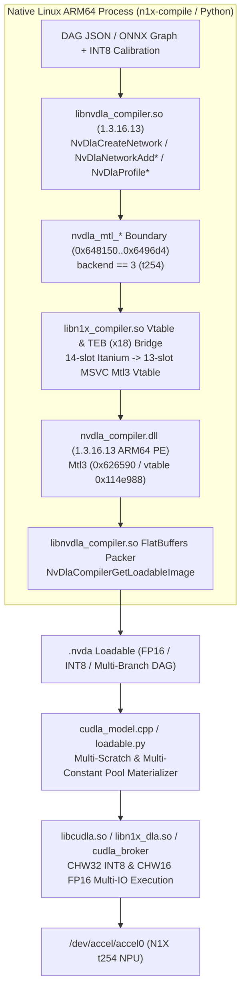

# N1X NPU Native C/C++ Compiler Adaptation, Full INT8, and DAG Graph Support

## Overview & Goals

### The Problem

While our Linux `/dev/accel/accel*` kernel driver ([`n1x_dla_accel.c`](../../driver/n1x_dla_accel.c)) and `cuDLA` userspace runtime ([`cudla_backend.cpp`](../../runtime/cudla_backend.cpp)) provide complete hardware submission, interrupt notification, layerwise profiling statistics, and job preemption on the physical N1X NPU (`t254`), the model compilation and loadable execution pipeline has four architectural limitations compared to Jetson and Windows:

1. **Stubbed `Mtl3` (`t254`) Backend in Linux `libnvdla_compiler.so` and Fragile Python/GDB/Unicorn Bridge**:
   - On both Jetson and Windows, DLA compilation is performed natively in C/C++ via `libnvdla_compiler.so` / `nvdla_compiler.dll` (`1.3.16.13`), which export the 655-function `NvDla*` C ABI ([`NvDlaType.h`](https://github.com/nvdla/sw/blob/master/umd/core/include/nvdla/c/NvDlaType.h), [`INetwork.h`](https://github.com/nvdla/sw/blob/master/umd/core/include/nvdla/INetwork.h)).
   - In NVIDIA's Linux ARM64 `libnvdla_compiler.so`, the complete C++ frontend (`nvdla::priv::CanonicalAST`, `engine_ast::*`, `LutManager`, INT8 quantization, FlatBuffers loadable packer) and the `nvdla_mtl_*` C boundary (`0x648150..0x6496d4`) are compiled in, but the `backend == 3` (`t254`) backend class (`Mtl3`) was compiled as `Mtl3Stub` (`0x649aa4`) and omitted from `nvdla_mtl_create` (`0x648150`), where `ctx->backend_obj` (`[ctx + 16]`) remains `NULL`.
   - Meanwhile, the Windows ARM64 `nvdla_compiler.dll` (`1.3.16.13`, built from the same source version for the same ARM64 ISA) contains the active `Mtl3` (`t254` Hummingbird) implementation (`0x626590` -> `0x617a70`, vtable `0x114e988`).
   - Instead of grafting `Mtl3` into `libnvdla_compiler.so` in C/C++, our existing scripts ([`probe_native_graph.py`](../../scripts/probe_native_graph.py) and [`compile_superres_backend.py`](../../scripts/compile_superres_backend.py)) spawn GDB twice to dump and reinject intermediate buffers and emulate `nvdla_compiler.dll` under Python Unicorn, requiring manual per-operator constant-pointer relocation (`+0x258` weight, `+0x160` bias).

2. **FP16-Only Compilation and Tensor Formats**:
   - [`probe_native_graph.py`](../../scripts/probe_native_graph.py) hardcodes `NvDlaWisdomSetDataType(..., 2)` and `NvDlaProfileSetComputePrecision(..., 2)` (`DATA_TYPE_HALF = 2`), and forces all input, intermediate, and output tensors to `DATA_TYPE_HALF` with `TENSOR_FORMAT_CHW16 = 3`.
   - Neither implicit INT8 calibration (`NvDlaProfileSetComputePrecision(..., 4)`, `NvDlaProfileSetQuantizationMode`, `NvDlaTensorSetChannelDynamicRange`, `NvDlaTensorSetChannelOffset`) nor explicit `Quantize`/`Dequantize` nodes (`NvDlaProfileSetIsExplicitQuantization`, `NvDlaNetworkAddQuantize`, `NvDlaNetworkAddDequantize`) nor `DATA_TYPE_INT8 = 4` (`TENSOR_FORMAT_CHW32 = 5` / `TENSOR_FORMAT_CHW16 = 3`) are exposed.

3. **Sequential Conv+ReLU Chain Restriction vs. Full DAGs**:
   - [`superres_graph.py`](../../scripts/superres_graph.py) and [`vision_graph.py`](../../scripts/vision_graph.py) only construct linear chains of `NvDlaNetworkAddConvolution` and `NvDlaNetworkAddActivation(RELU)`.
   - Because branching DAG topologies and operators such as `ElementWise` (residual `Add`), `Pooling` (`MaxPool`, `AvgPool`), `Scale` / `BatchNorm`, `Concatenation`, `FullyConnected`, `Deconvolution`, and `PixelShuffle` / `Resize` are not lowered, [`demo/vision.py`](../../demo/vision.py) splits ResNet-18 into 12 separate convolution-only loadables and executes `MaxPool`, residual `Add`, `GlobalAveragePool`, and `Linear` on the CPU.

4. **Single-Buffer Assumptions in Loadable Materializers and Runtime Helpers**:
   - [`Model::Model`](../../runtime/cudla_model.cpp) in [`runtime/cudla_model.cpp`](../../runtime/cudla_model.cpp) and [`materialize_loadable`](../../runtime/loadable.py) in [`runtime/loadable.py`](../../runtime/loadable.py) require a single scratch buffer at offset `0` (`bytes >= property_local_dram_pool_size`) and a single constant memory entry (`constants.size() == 1`). Multi-branch DAGs and INT8 networks that emit multiple scratch allocations or multiple constant initializers are rejected at load time.
   - [`runtime/n1x_dla.py`](../../runtime/n1x_dla.py) and [`runtime/cudla_broker.cpp`](../../runtime/cudla_broker.cpp) lack `CHW32` and `CHW16` INT8 tensor packing/unpacking and multi-input/multi-output task binding helpers.

### Overview

We will replace the Python/GDB/Unicorn compilation bridge with a **native C/C++ compiler adapter library (`libn1x_compiler.so`) and CLI (`n1x-compile`)** that adapts Linux `libnvdla_compiler.so` in-process, and extend the loadable materializer and runtime stack for full DAG and INT8 execution:

1. **In-Process Native ARM64 `Mtl3` Backend Graft (`runtime/n1x_compiler_shim.cpp`, `libn1x_compiler.so`)**:
   - Load `libnvdla_compiler.so` and map the ARM64 PE image of `nvdla_compiler.dll` into the same native Linux ARM64 process.
   - Provide lightweight native C implementations of the ~25 Windows CRT/Win32 imports (`HeapAlloc`, `FlsGetValue`, virtual `/graph` in-memory directory fixture, and `x18` TEB register save/restore trampolines) and run the DLL's 1,767 C++ static initializers once on library load.
   - Intercept `nvdla_mtl_create` (`0x648150`) and the `nvdla_mtl_*` boundary (`0x6481f0..0x6496d4`) in `libnvdla_compiler.so` so `backend == 3` (`t254`) instantiates and dispatches directly to the native ARM64 `Mtl3` object (`0x626590` -> `0x617a70`) in the same address space.
   - Because the Linux frontend (`nvdla::priv::MTL`) and the `t254` `Mtl3` backend execute in the same process memory space, all `nvdla_mtl3_desc_entry_list` buffers and all weight, bias, batch-norm, and INT8 scale/zero-point pointers are valid native pointers—eliminating GDB, Unicorn, and manual pointer relocation.
2. **Native C/C++ DAG & INT8 Compiler API and CLI (`runtime/n1x_compile.cpp`, `include/n1x_compiler.h`)**:
   - Expose the full `NvDla*` C API (`NvDlaCreateWisdom`, `NvDlaCreateNetwork`, `NvDlaNetworkAdd*`, `NvDlaProfileSetComputePrecision`, `NvDlaCompilerCompile`, `NvDlaCompilerGetLoadableImage`) from `libn1x_compiler.so`.
   - Build a native C++ compiler tool (`n1x-compile`) and Python Ctypes binding (`runtime/n1x_compiler.py`) that compile declarative DAG specifications and ONNX graphs containing arbitrary supported operators (`Convolution`, `Deconvolution`, `FullyConnected`, `Activation`, `Pooling`, `ElementWise`, `Scale`, `BatchNorm`, `Concatenation`, `PixelShuffle`, `Slice`, `Quantize`, `Dequantize`) in both `FP16` and `INT8` (implicit dynamic-range calibration and explicit `Q/DQ`) directly into `.nvda` loadables in milliseconds.
3. **Multi-Pool Loadable Validation & INT8/Multi-IO Runtime Support (`runtime/cudla_model.cpp`, `runtime/loadable.py`, `runtime/n1x_dla.py`, `runtime/cudla_broker.cpp`, `runtime/cudla_broker.py`)**:
   - Generalize [`Model::Model`](../../runtime/cudla_model.cpp) and [`materialize_loadable`](../../runtime/loadable.py) to validate multi-entry local DRAM scratch pools and multi-entry global DRAM constant pools while remaining fail-closed on out-of-bounds ranges.
   - Add `CHW32` and `CHW16` INT8 packing/unpacking (`pack_chw32_int8`, `unpack_chw32_int8`, `pack_chw16_int8`, `unpack_chw16_int8`, and scale/quantize helpers) and multi-input/multi-output tensor execution in [`runtime/n1x_dla.py`](../../runtime/n1x_dla.py) and [`runtime/cudla_broker.cpp`](../../runtime/cudla_broker.cpp).
4. **End-to-End Unified DAG & INT8 Hardware Qualification (`demo/vision.py`, `scripts/test_dla_runtime.py`, `scripts/test_linux_accel.py`, `scripts/test_cudla_api.cpp`)**:
   - Compile and qualify a unified multi-branch residual graph (`Convolution`, `Scale`/`BatchNorm`, `Activation`, `Pooling`, and `ElementWise` `SUM` in a single loadable) and an INT8 quantized loadable natively via `libn1x_compiler.so` and execute them on the physical N1X NPU.

### Goals

- **Native In-Process C/C++ Compilation on Linux ARM64**: Adapt `libnvdla_compiler.so` via in-process native ARM64 `Mtl3` grafting so `NvDlaCompilerCompile` runs natively in C/C++ without GDB, Unicorn, or manual pointer fixups.
- **Full DAG & Operator Coverage**: Support multi-input, multi-output branching DAGs with `Convolution` (standard, strided, dilated, grouped/depthwise), `Deconvolution`, `FullyConnected`, `Activation` (`RELU`, `CLIP`, `SIGMOID`, `TANH`, `LEAKY`), `Pooling` (`MAX`, `MIN`, `AVERAGE`), `ElementWise` (`SUM`, `PROD`, `MAX`, `MIN`, `SUB`, `DIV`), `Scale`, `BatchNorm`, `Concatenation`, `PixelShuffle`, `Slice`, `Quantize`, and `Dequantize`.
- **Full INT8 Precision Support**: Support implicit INT8 calibration (`NvDlaProfileSetComputePrecision(INT8)`, per-tensor and per-channel quantization modes, `NvDlaTensorSetChannelDynamicRange`) and explicit `Quantize`/`Dequantize` layers, with `INT8` (`CHW32` and `CHW16`) and mixed `FP16`-I/O / `INT8`-compute tensor bindings.
- **Generalized Loadable Materializer & Runtime I/O**: Support multi-scratch and multi-constant memory pools in [`runtime/cudla_model.cpp`](../../runtime/cudla_model.cpp) and [`runtime/loadable.py`](../../runtime/loadable.py), plus INT8 packing and multi-input/multi-output task execution in `libn1x_dla` and `cudla_broker`.
- **Physical N1X Qualification**: Verify native C/C++ compilation and hardware execution of a unified residual DAG loadable and an INT8 loadable against CPU reference oracles.

### Non-Goals

- **Rewriting the Hummingbird Microcode Backend from Scratch in Open-Source `nvdla/sw`**: The 2018 open-source `nvdla/sw` repository targets NVDLA 1.0 register lists and lacks the DLA 3.16 RVV/Hummingbird instruction emitter; we use its public C/C++ ABI headers while grafting the verified `1.3.16.13` `Mtl3` binary backend.
- **Dynamic Tensor Shapes or Batch Sizes > 1**: The N1X `t254` DLA compiler and firmware require static dimensions with `N = 1`.
- **Kernel Driver UAPI Modifications**: The `/dev/accel/accel*` kernel driver is already topology- and precision-agnostic.

---

## Technical Plan

### Architecture Overview

The compilation and execution pipeline is divided into four layers:

1. **In-Process `Mtl3` Native ARM64 Adapter (`libn1x_compiler.so`)**: Maps `libnvdla_compiler.so` and the ARM64 PE image of `nvdla_compiler.dll` into a single Linux process, resolves the 1-slot Itanium-vs-MSVC C++ vtable offset on `Mtl3`, and enables native in-process `NvDlaCompilerCompile` calls for target `t254`.
2. **Declarative DAG & INT8 Compiler Frontend (`n1x-compile` & `runtime/n1x_compiler.py`)**: Lowers multi-branch DAGs and ONNX graphs across all supported DLA operators and INT8 quantization modes (implicit dynamic range and explicit `Q/DQ`) through the `NvDla*` C API.
3. **Generalized Loadable Materializer (`runtime/cudla_model.cpp` & `runtime/loadable.py`)**: Validates multi-scratch local DRAM pools, multi-initializer global DRAM constant pools, and `FP16`/`INT8` tensor descriptors.
4. **Multi-IO & INT8 Runtime Execution (`runtime/n1x_dla.py`, `runtime/cudla_broker.cpp`, `runtime/cudla_broker.py`)**: Provides `CHW32`/`CHW16` INT8 tensor packing/unpacking, dynamic-range quantization helpers, and multi-input/multi-output task submission.

---

### 1. In-Process Native ARM64 `Mtl3` Backend Graft (`runtime/n1x_compiler_shim.cpp`)

#### Binary Contract Between `libnvdla_compiler.so` and `nvdla_compiler.dll`

Both `libnvdla_compiler.so` (SHA-256 `28668e74...`) and `nvdla_compiler.dll` (SHA-256 `0ef7c936...`) are compiled from NVIDIA DLA compiler version `1.3.16.13` for ARM64 (`aarch64`).

In `libnvdla_compiler.so`, all 13 `nvdla_mtl_*` functions (`0x648150..0x6496d4`) already implement the `backend == 3` (`t254`) dispatch path against an `Mtl3*` pointer stored at `[ctx + 16]`. The only differences between the Linux `Mtl3Stub` (`0xc83e68`) and the Windows `Mtl3` implementation (`0x114e988`) are:
1. **`nvdla_mtl_create` (`0x648150`)**: On Linux, when `w20 == 3` (`0x648190`), the allocation call for `ctx->backend_obj` (`[ctx + 16]`) was omitted by `#ifdef`, leaving `[ctx + 16] == NULL` and jumping to `free(ctx)`. On Windows (`0x4ca948`), `backend == 3` calls factory `0x626590` (allocating 232 bytes and running `Mtl3::Mtl3()` at `0x617a70`) and stores the pointer at `[ctx + 16]`.
2. **`nvdla_mtl_get_version` (`0x649520`) and `nvdla_mtl_get_stat_version` (`0x6496d4`)**: On Linux, these stack-allocate a 112-byte `Mtl3Stub` via `Mtl3Stub::Mtl3Stub()` (`0x649aa4`), which returns error `2001` (`0x7d1`) for all queries.
3. **Itanium vs. MSVC C++ Vtable Layout**: Linux uses the Itanium C++ ABI, which places two destructor slots (`D1` complete destructor at `+0` and `D0` deleting destructor at `+8`) at the start of the vtable, whereas Windows MSVC ARM64 places a single scalar deleting destructor at `+0`. Every virtual method after the destructor is in the identical order, shifted by `+8` bytes:

| Method | Linux Itanium Vtable Offset (`0xc83e68`) | Windows MSVC Vtable Offset (`0x114e988`) | Windows Target RVA |
| --- | --- | --- | --- |
| `~Mtl3()` (D1 complete) | `+0` (slot 0) | `+0` (slot 0, with `w1 = 0`) | `0x61c070` |
| `~Mtl3()` (D0 deleting) | `+8` (slot 1) | `+0` (slot 0, with `w1 = 1`) | `0x61c070` |
| `setLogPath` | `+16` (slot 2) | `+8` (slot 1) | `0x6244b0` |
| `mtlSetDeviceMiscConfig` | `+24` (slot 3) | `+16` (slot 2) | `0x624ea0` |
| `mtlQueryDeviceInfo` | `+32` (slot 4) | `+24` (slot 3) | `0x53790` |
| `mtlPreTranslate` | `+40` (slot 5) | `+32` (slot 4) | `0x624630` |
| `mtlTranslate` | `+48` (slot 6) | `+40` (slot 5) | `0x624eb0` |
| `mtlPostTranslate` | `+56` (slot 7) | `+48` (slot 6) | `0x6244d0` |
| `mtlGetMetrics` | `+64` (slot 8) | `+56` (slot 7) | `0x624480` |
| `mtlGetBlobBufferSize` | `+72` (slot 9) | `+64` (slot 8) | `0x624420` |
| `mtlCopyBlobBuffer` | `+80` (slot 10) | `+72` (slot 9) | `0x6243a0` |
| `mtlGetVersion` | `+88` (slot 11) | `+80` (slot 10) | `0x629d80` |
| `enableSwitchPoint` | `+96` (slot 12) | `+88` (slot 11) | `0x53790` |
| `disableSwitchPoint` | `+104` (slot 13) | `+96` (slot 12) | `0x53790` |

#### In-Process PE Loader, Win32 Import Thunks, and `x18` TEB Bridge

`libn1x_compiler.so` (`runtime/n1x_compiler_shim.cpp`) performs a deterministic, one-time initialization (`pthread_once`):
1. **Verify Pinned Binary Digests**: Compute SHA-256 of `libnvdla_compiler.so` (`28668e74...`) and `nvdla_compiler.dll` (`0ef7c936...`) before mapping; fail closed on mismatch.
2. **Map `nvdla_compiler.dll` PE Sections**: Map the PE headers and sections into a contiguous `mmap` region (`PROT_READ | PROT_WRITE | PROT_EXEC`), apply PE base relocations (`IMAGE_REL_BASED_DIR64`) if the mapped base differs from `ImageBase` (`0x180000000`), and initialize the PE `.tls` template into a 64-slot TLS array referenced by a modeled 4-KiB Windows `TEB` (with stack base/limit populated from `pthread_getattr_np` so MSVC `__chkstk` stack probes succeed natively).
3. **Bind PE Imports (`KERNEL32.dll`, `ADVAPI32.dll`, `dbghelp.dll`)**: Point each IAT entry at a native C thunk that saves/restores `x18` (`TEB`):
   - Heap & memory: `GetProcessHeap`, `HeapAlloc`, `HeapReAlloc`, `HeapFree`, `HeapSize`, `VirtualProtect` -> backed by `malloc`/`calloc`/`realloc`/`free` (tracking allocation sizes for `HeapSize`).
   - TLS / FLS / Synchronization: `TlsAlloc`, `TlsGetValue`, `TlsSetValue`, `TlsFree`, `FlsAlloc`, `FlsGetValue`, `FlsSetValue`, `FlsFree`, `InitializeCriticalSectionEx`, `EnterCriticalSection`, `LeaveCriticalSection`, `DeleteCriticalSection`, `InitializeSRWLock`, `AcquireSRWLockExclusive`, `ReleaseSRWLockExclusive`, `EncodePointer`, `DecodePointer`.
   - Virtual filesystem & environment: `GetEnvironmentVariableA`/`W` (returning `0` / `ERROR_ENVVAR_NOT_FOUND` for debug/random seeds so deterministic codegen runs), `GetFileAttributesExW` / `CreateFileW` / `CreateDirectoryW` (modeling absent `./compile_opt.json` and virtual `/graph`, `/graph/kernel_compile`, `/graph/linker` directories in memory without touching the host filesystem), `MultiByteToWideChar`, `WideCharToMultiByte`.
   - Timing & process info: `QueryPerformanceCounter`, `QueryPerformanceFrequency`, `GetCurrentProcessId`, `GetCurrentThreadId`, `GetSystemTimeAsFileTime`.
4. **Execute PE CRT and C++ Static Initializers**: Using an inline assembly trampoline that sets `x18` to the modeled `TEB`, execute the CRT initializers (`0xf190e0` locale, `0xf267d0` heap, `0xf1dce0`/`0xf2fa98` FLS, `0xf1f750` lowio, `0xf07dc0` stdio) followed by `_initterm` (`0xf19358`) across `0x10523b0, 0x1055af0)` (all 1,767 C++ static initializers, including the Hummingbird IR and target lookup tables).
5. **Install the 14-Slot Itanium `Mtl3` Vtable and Hook `nvdla_mtl_create`**:
   - Construct a static 14-entry Itanium vtable (`g_linux_mtl3_vtable`) whose slots point to assembly trampolines that set `x18 = g_win_teb`, invoke the corresponding Windows `Mtl3` method (`0x61c070`, `0x6244b0`, `0x624ea0`, `0x53790`, `0x624630`, `0x624eb0`, `0x6244d0`, `0x624480`, `0x624420`, `0x6243a0`, `0x629d80`), and restore `x18`.
   - Patch `nvdla_mtl_create` (`0x648198` in [`libnvdla_compiler.so`) and `nvdla_mtl_get_version` / `nvdla_mtl_get_stat_version` (`0x649520` / `0x6496d4`) in memory (`mprotect`) so that when `backend == 3`:
     - `nvdla_mtl_create` calls the Windows `Mtl3` factory (`0x626590`), overwrites its vtable pointer (`*obj`) with `g_linux_mtl3_vtable`, stores `obj` at `[ctx + 16]`, and returns `ctx`.
     - `nvdla_mtl_get_version` and `nvdla_mtl_get_stat_version` query `0x629d80` (`mtlGetVersion`) on a temporary `Mtl3` instance.

Because both `nvdla::priv::MTL` (in `libnvdla_compiler.so`) and `Mtl3` (in `nvdla_compiler.dll`) now execute inside the **same virtual address space**:
- `mtlPreTranslate` (`0x624630`) and `mtlTranslate` (`0x624eb0`) read and mutate the native `nvdla_mtl3_desc_entry_list` buffers (`kind 0..4`) directly in place.
- Every constant pointer (`weights`, `bias`, `scale`, `batch_norm`, `lut`, `q_scale`) allocated by `libnvdla_compiler.so` in `kind 3` (`nvdla_mtl_operation_container`) is already a valid in-process pointer readable by `Mtl3`.

---

### 2. Full DAG Operator & INT8 Quantization Support (`runtime/n1x_compile.cpp` & `runtime/n1x_compiler.py`)

With `libnvdla_compiler.so` executing natively in-process for `t254`, we expose a complete graph builder in C++ (`runtime/n1x_compile.cpp`) and Python (`runtime/n1x_compiler.py`) that compiles both declarative JSON DAGs and ONNX models directly to `.nvda` loadables.

#### Supported DAG Operators and C API Lowering

A graph is a directed acyclic graph (DAG) with one or more named input tensors, an ordered topological list of operator nodes referencing upstream tensor names by ID, and one or more named output tensors:

| Operator Type | `libnvdla_compiler.so` C API Entrypoint | Supported Parameters & Modes |
| --- | --- | --- |
| `Convolution` | `NvDlaNetworkAddConvolution` | `kernel_h/w`, `stride_h/w`, `pad_top/bottom/left/right`, `dilation_h/w`, `num_groups` (standard, strided, dilated, grouped, depthwise), `weights`, optional `bias`, `bias_mode` (`NONE=0`, `UNIFORM=1`, `CHANNEL=2`, `ELEMENTWISE=3`) |
| `Deconvolution` | `NvDlaNetworkAddDeconvolution` | `kernel_h/w`, `stride_h/w`, `pad_top/bottom/left/right`, `dilation_h/w`, `num_groups`, `weights`, optional `bias` |
| `FullyConnected` | `NvDlaNetworkAddFullyConnected` | `num_output_channels`, `weights`, optional `bias`, `bias_mode` |
| `Activation` | `NvDlaNetworkAddActivation` / `NvDlaActivationLayerSetClip` / `NvDlaNetworkAddActivationWeights` | `RELU=0`, `SIGMOID=1`, `TANH=2`, `CLIP=3` (`min`, `max`, including `ReLU6`), `LEAKY=4` (`slope` via weights) |
| `Pooling` | `NvDlaNetworkAddPooling` / `NvDlaNetworkAddPoolingExt` | `MAX=0`, `MIN=1`, `AVERAGE=2`; `window_h/w`, `stride_h/w`, `pad_top/bottom/left/right`, ` avg_pooling_padding_mode` (`EXCLUDE_PADDING=0`, `INCLUDE_PADDING=1`) |
| `ElementWise` | `NvDlaNetworkAddElementWise` | Two input tensors (`input0`, `input1`); operations `PROD=0`, `SUM=1` (residual `Add`), `MAX=2`, `MIN=3`, `SUB=4`, `DIV=5`, `POW=6` |
| `Scale` | `NvDlaNetworkAddScale` | `mode` (`UNIFORM=1`, `CHANNEL=2`, `ELEMENTWISE=3`), `shift`, `scale`, `power` |
| `BatchNorm` | `NvDlaNetworkAddBatchNorm` | `mode` (`UNIFORM=1`, `CHANNEL=2`), `mean`, `variance`, `epsilon` |
| `Concatenation` | `NvDlaNetworkAddConcatenation` / `NvDlaConcatenationLayerSetAxis` | `inputs[]` (`num_inputs >= 2`), channel/axis concatenation |
| `Slice` | `NvDlaNetworkAddSlice` / `NvDlaNetworkAddSliceSplit` | `offset`, `size`, `stride`, `mode` |
| `PixelShuffle` | `NvDlaNetworkAddPixelShuffle` | `upscale_factor` (e.g., `3` for 3x super-resolution) |
| `Resize` | `NvDlaNetworkAddResize` / `NvDlaNetworkAddResizeOutputDims` | `scale_h/w` or `output_dims`, `mode` (`NEAREST`, `LINEAR`) |
| `Quantize` | `NvDlaNetworkAddQuantize` | Explicit quantization: `scales`, `zero_points`, `axis` |
| `Dequantize` | `NvDlaNetworkAddDequantize` | Explicit dequantization: `scales`, `zero_points`, `axis` |

#### Full INT8 Precision and Quantization Modes

The compiler supports three precision configurations controlled per graph profile:

1. **Pure FP16 (`compute_precision = "fp16"`)**:
   - `NvDlaWisdomSetDataType(wisdom, 2)` (`HALF`), `NvDlaProfileSetComputePrecision(profile, 2)` (`HALF`).
   - Input/output tensors default to `DATA_TYPE_HALF = 2`, `TENSOR_FORMAT_CHW16 = 3`.
2. **Implicit INT8 Calibration (`compute_precision = "int8"`, `explicit_qdq = false`)**:
   - `NvDlaWisdomSetDataType(wisdom, 4)` (`INT8`), `NvDlaProfileSetComputePrecision(profile, 4)` (`INT8`).
   - `NvDlaProfileSetQuantizationMode(profile, mode)`: supports `PER_KERNEL = 0` (per-channel weight quantization) and `PER_FILTER = 1` (per-tensor quantization).
   - `NvDlaProfileSetTensorScalingMode(profile, mode)`: supports `PER_TENSOR = 0` and `PER_CHANNEL = 1`.
   - For every input, output, and layer output tensor in the graph, `NvDlaTensorSetChannelDynamicRange(tensor, min_val, max_val)` (and optional `NvDlaTensorSetChannelOffset`) sets the calibrated dynamic range (`[-127 * scale, +127 * scale]`). If a node omits explicit calibration ranges, a default symmetric range is derived from its weight/activation statistics or a user-supplied calibration dictionary.
   - Input and output tensors can be bound independently as either:
     - **Native INT8 I/O**: `NvDlaTensorSetDataType(tensor, 4)` (`INT8`) with `NvDlaTensorSetTensorFormat(tensor, 5)` (`TENSOR_FORMAT_CHW32 = 5`) or `3` (`TENSOR_FORMAT_CHW16 = 3`), or
     - **Mixed FP16 I/O with INT8 Compute**: `NvDlaTensorSetDataType(tensor, 2)` (`HALF`) with `TENSOR_FORMAT_CHW16 = 3` on network inputs/outputs while internal layers execute in `INT8`.
3. **Explicit Quantize / Dequantize (`compute_precision = "int8"`, `explicit_qdq = true`)**:
   - `NvDlaProfileSetIsExplicitQuantization(profile, 1)`.
   - Lowers ONNX `QuantizeLinear` / `DequantizeLinear` nodes directly to `NvDlaNetworkAddQuantize` and `NvDlaNetworkAddDequantize` with `NvDlaQuantizeLayerSetScales`, `NvDlaQuantizeLayerSetZeroPoints`, and `NvDlaQuantizeLayerSetAxis`.

---

### 3. Generalized Loadable Materializer (`runtime/cudla_model.cpp` & `runtime/loadable.py`)

Complex branching DAGs (such as multi-block residual networks) and INT8 loadables with separate weight and scale/LUT initializers can emit:
- Multiple local DRAM scratch memory entries (or scratch buffers at non-zero offsets within the memory list) whose combined sizes cover `property_local_dram_pool_size`.
- Multiple constant memory entries (`flags == 3`) or multiple raw interface-0 initializer blobs within the global DRAM constant pool (`property_global_dram_pool_size`).
- Input/output tensor descriptors with `dataType == CUDLA_DATA_TYPE_INT8` (`4`) as well as `CUDLA_DATA_TYPE_HALF` (`2`), and `dataFormat` values including `CHW32` (`5`) and `CHW16` (`3`).

We will update both [`Model::Model`](../../runtime/cudla_model.cpp) in [`runtime/cudla_model.cpp`](../../runtime/cudla_model.cpp) and [`materialize_loadable`](../../runtime/loadable.py) in [`runtime/loadable.py`](../../runtime/loadable.py):
1. **Local DRAM Scratch Pool Coverage**:
   - Sum the covered bytes across all unique task address entries referencing scratch memory (`memory.scratch == true`, `flags == 1` with empty content names), and verify that the total task-addressed scratch capacity is `>= pools["property_local_dram_pool_size"]`.
2. **Global DRAM Constant Pool Coverage**:
   - Allow one or more constant memory entries (`constants.size() >= 1`), verify that every constant memory entry has `flags == 3` (`ALLOC | SET`), `valid == true`, and is completely covered by at least one task address range in `ranges`, and verify that the sum of `high` extents across constant memories equals `pools["property_global_dram_pool_size"]`.

---

### 4. INT8 Tensor Packing & Multi-IO Runtime Support (`runtime/n1x_dla.py`, `runtime/cudla_broker.cpp`, `runtime/cudla_broker.py`)

#### INT8 and FP16 Hardware Tensor Layouts

On DLA 3.16 (`t254`), the hardware surface formats for feature-data tensors (`dataCategory == 1`) are:
- **`TENSOR_FORMAT_CHW16` (`dataFormat == 3`)**: Channels grouped into blocks of 16 (`ceil(C / 16)` blocks of `[H, W, 16]`), with 256-byte row alignment (`stride[1] = align(W * 16 * elem_bytes, 256)`). Used for `FP16` (`elem_bytes = 2`, 32 bytes/pixel-group) and `INT8` (`elem_bytes = 1`, 16 bytes/pixel-group).
- **`TENSOR_FORMAT_CHW32` (`dataFormat == 5`)**: Channels grouped into blocks of 32 (`ceil(C / 32)` blocks of `[H, W, 32]`), with 256-byte row alignment (`stride[1] = align(W * 32 * elem_bytes, 256)`). Used as the native high-throughput format for `INT8` (`elem_bytes = 1`, 32 bytes/pixel-group).

We will add to [`runtime/n1x_dla.py`](../../runtime/n1x_dla.py):
- `pack_chw32_int8(nchw, stride_w=None)` and `unpack_chw32_int8(packed, shape, stride_w=None)`
- `pack_chw16_int8(nchw, stride_w=None)` and `unpack_chw16_int8(packed, shape, stride_w=None)`
- `quantize_int8(fp_array, scale)` and `dequantize_int8(int8_array, scale)`
- `pack_tensor_for_desc(array, desc, scale=1.0)` and `unpack_tensor_from_desc(raw_bytes, desc, scale=1.0)`: inspects `desc.dataType` (`HALF=2`, `INT8=4`), `desc.dataFormat` (`CHW16=3`, `CHW32=5`), and `desc.stride[0..3]` from the loadable tensor descriptor to pack/unpack any tensor according to its exact compiled stride and format.
- Update [`runtime/cudla_broker.cpp`](../../runtime/cudla_broker.cpp) and [`runtime/cudla_broker.py`](../../runtime/cudla_broker.py) so a single loaded model in the broker can bind arbitrary numbers of input and output tensors (`numInputTensors >= 1`, `numOutputTensors >= 1`) and report each tensor's `dataType`, `dataFormat`, and `stride` array in the JSON `load` response.

---

## Alternatives Considered

### 1. Extending the Python + GDB + Unicorn Hybrid Bridge (`probe_native_graph.py` + `compile_superres_backend.py`)

- **Approach**: Keep the two-stage GDB capture/replay scripts (`capture_native_mtl.gdb`, `capture_native_translate.gdb`, `package_windows_output.gdb`) and extend the Python Unicorn emulator script ([`compile_superres_backend.py`](../../scripts/compile_superres_backend.py)) to relocate constant pointers for every new operator (`Scale`, `BatchNorm`, `FullyConnected`, `Deconvolution`, `Quantize`, `Dequantize`, and activation LUTs).
- **Trade-offs**:
  - *Pros*: Reuses the existing Unicorn test harness without writing a native C/C++ PE loader shim.
  - *Cons*: Spawns two GDB processes per compilation, emulates hundreds of millions of ARM64 instructions in software on an already-native ARM64 CPU (taking tens of seconds to minutes per model), and requires reverse-engineering exact byte offsets inside the 34,816-byte `kind 3` (`nvdla_mtl_operation_container`) union for every operator and quantization mode. Any missed pointer offset causes a silent read fault or corrupted weights inside Unicorn.
- **Decision**: Rejected. Grafting `Mtl3` into `libnvdla_compiler.so` in-process executes natively on the ARM64 CPU in milliseconds and eliminates manual constant-pointer relocation because the Linux frontend and `Mtl3` backend share a single virtual address space.

### 2. Forking the 2018 Open-Source `github.com/nvdla/sw` Compiler Repository

- **Approach**: Fork NVIDIA's open-source [`nvdla/sw`](https://github.com/nvdla/sw) C++ compiler codebase and modify it to emit N1X (`t254`) `.nvda` loadables.
- **Trade-offs**:
  - *Pros*: Provides modifiable C++ source code for the frontend parser and AST passes.
  - *Cons*: Open-source `nvdla/sw` targets NVDLA 1.0 (`nv_full` / `nv_small` and Xavier `1.x`), whose backend emits fixed-function hardware register lists (`OperationList`, `SurfaceList`, `LutList`). The N1X NPU (`t254`, DLA 3.16) uses the proprietary Hummingbird / RVV instruction-stream architecture (`CPIPE0..3` execution streams, 256-byte `task-0-net` binary headers, and ~28-KiB per-layer `task-0-rvv-mem` microcode binaries). None of the 16-MiB Hummingbird IR builder, register allocator, or microcode assembler exists in `nvdla/sw`.
- **Decision**: Rejected for backend code generation. We adopt the public `nvdla/sw` C ABI declarations (`NvDlaType.h`) for our native C/C++ frontend while grafting the verified `1.3.16.13` `Mtl3` binary backend from `nvdla_compiler.dll` into `libnvdla_compiler.so`.

### 3. Calling the Windows `nvdla_compiler.dll` C API Frontend Directly Instead of Grafting `Mtl3` into Linux `libnvdla_compiler.so`

- **Approach**: Map `nvdla_compiler.dll` into a Linux process and invoke its exported `NvDlaCreateNetwork` / `NvDlaCompilerCompile` PE exports directly, bypassing Linux `libnvdla_compiler.so` altogether.
- **Trade-offs**:
  - *Pros*: Uses a single vendor binary (`nvdla_compiler.dll`) rather than combining `libnvdla_compiler.so` and `nvdla_compiler.dll`.
  - *Cons*: Every `NvDla*` call into `nvdla_compiler.dll` would require an `x18` TEB trampoline, and the Windows frontend exercises a much broader surface of Windows CRT APIs, MSVC C++ exception handling (`__CxxFrameHandler4` / `.pdata` unwind tables), and Windows thread-local storage across AST canonicalization and FlatBuffers serialization. By contrast, Linux `libnvdla_compiler.so` runs all frontend graph construction, optimization, INT8 calibration, and FlatBuffers serialization natively against Linux `glibc` and `libstdc++`, crossing into `Mtl3` only at the 12-method `nvdla_mtl_*` boundary (`0x648150..0x6496d4`), whose required Win32 imports (~25 functions) are already enumerated and verified in [`compile_superres_backend.py`](../../scripts/compile_superres_backend.py).
- **Decision**: Rejected. Grafting `Mtl3` at the `nvdla_mtl_*` boundary keeps the entire `NvDla*` C API native Linux ELF code and confines the PE compatibility layer to the already-characterized `Mtl3` backend methods.

### 4. INT8 Quantization Approaches: Implicit Calibration vs. Explicit Q/DQ vs. TensorRT Builder (`nvinfer_11.dll` + `nvonnxparser_11.dll`)

NVIDIA's DLA stack supports three mechanisms for producing INT8 loadables. We evaluated how each maps onto `libnvdla_compiler.so` (`1.3.16.13`) and the `Mtl3` (`t254`) backend:

| Dimension | Option A: Implicit Dynamic-Range Calibration (`NvDlaTensorSetChannelDynamicRange`) | Option B: Explicit `Q/DQ` Graph Nodes (`NvDlaNetworkAddQuantize` / `Dequantize`) | Option C: Hosting Windows TensorRT Builder (`nvinfer_11.dll` + `nvonnxparser_11.dll`) |
| --- | --- | --- | --- |
| **Input Model Format** | Standard FP32/FP16 ONNX or DAG JSON + calibration dictionary (per-tensor or per-channel `[min, max]` ranges) | QAT / PTQ ONNX models exported from PyTorch (`torch.ao.quantization` / TensorRT Model Optimizer) with `QuantizeLinear` / `DequantizeLinear` nodes | FP32/FP16 ONNX + `IInt8Calibrator` C++ callback or `Q/DQ` ONNX |
| **Compiler C API Surface** | `NvDlaProfileSetComputePrecision(4)`, `NvDlaProfileSetQuantizationMode`, `NvDlaProfileSetTensorScalingMode`, `NvDlaTensorSetChannelDynamicRange`, `NvDlaLayerSetComputePrecision` | `NvDlaProfileSetIsExplicitQuantization(1)`, `NvDlaNetworkAddQuantize`, `NvDlaNetworkAddDequantize`, `NvDlaQuantizeLayerSetScales` / `ZeroPoints` / `Axis` / `BlockSize` | `createInferBuilder_INTERNAL`, `createNvOnnxParser_INTERNAL` inside 200+ MiB Windows PE DLLs |
| **Weight Quantization** | Compiler automatically quantizes FP32/FP16 weights to INT8 (`PER_KERNEL` per-channel or `PER_FILTER` per-tensor) and computes SDP rescale factors | Scales and zero-points are fixed by the `QuantizeLinear` / `DequantizeLinear` node weights in the ONNX graph | TensorRT folds or lowers `Q/DQ` into `NvDla*` C API calls before invoking `nvdla_compiler.dll` |
| **Mixed FP16 / INT8 Layer Fallback** | Supported directly via `NvDlaLayerSupportsComputePrecision` and `NvDlaLayerSetComputePrecision(layer, HALF/INT8)` | Controlled by placement of `Quantize` / `Dequantize` boundary nodes around sensitive subgraphs | Controlled by TensorRT layer precision constraints |
| **Runtime & OS Dependencies** | Zero external dependencies beyond `libnvdla_compiler.so` + `Mtl3` graft | Zero external dependencies beyond `libnvdla_compiler.so` + `Mtl3` graft | Requires emulating/shimming `nvinfer_11.dll` CUDA runtime (`cudart64_13.dll`, `nvcuda.dll`) queries and Windows calibration cache I/O |

- **Trade-offs**:
  - *Option A only (Implicit Calibration only)*: Simplifies converting existing FP32/FP16 models (such as `super-resolution-10.onnx`, `dncnn`, and `resnet18.onnx`) because weights remain FP32 in the source model and the compiler computes INT8 weight scales and SDP rescaling factors from activation `[min, max]` ranges. However, it cannot directly ingest pre-quantized ONNX models that encode scales in `QuantizeLinear` / `DequantizeLinear` operators.
  - *Option B only (Explicit Q/DQ only)*: Directly ingests ONNX `QuantizeLinear` / `DequantizeLinear` graphs exported by modern PyTorch / ONNX Runtime quantization tools, including per-axis (`NvDlaQuantizeLayerSetAxis`) and blockwise (`NvDlaQuantizeLayerSetBlockSize`) scales, but requires re-exporting FP32 models with explicit `Q/DQ` pairs around every layer.
  - *Option C (Hosting `nvinfer_11.dll` + `nvonnxparser_11.dll`)*: In TensorRT 11.4, `nvinfer_11.dll` is a GPU-first builder that queries CUDA device properties (`cuInit`, `cudaGetDeviceProperties`) during builder initialization even when `--useDLACore=0` is set, and ultimately lowers DLA subgraphs into the exact same `NvDla*` C API exported by `libnvdla_compiler.so`.
- **Decision**: Support **both Option A (Implicit Dynamic-Range Calibration with per-layer mixed precision via `NvDlaLayerSetComputePrecision`) and Option B (Explicit `Q/DQ` via `NvDlaNetworkAddQuantize` / `NvDlaNetworkAddDequantize`)** directly in our native `libn1x_compiler.so` and `n1x-compile` frontend, and reject Option C (`nvinfer_11.dll`). This gives users both calibration-driven INT8 compilation for existing FP32/FP16 ONNX models and direct compilation of QAT/PTQ `Q/DQ` ONNX graphs without pulling in Windows CUDA DLL dependencies.

---

## Detailed Implementation

### 1. Native C/C++ Compiler Header (`include/n1x_compiler.h`) — *New File*

- **Purpose**: Declare the public C ABI for `libn1x_compiler.so`, including the `NvDla*` C types (aligned with open-source `nvdla/sw` `NvDlaType.h` and `1.3.16.13` extensions) and high-level graph/loadable compilation entrypoints.
- **Types and Constants**:
  - `N1xDlaDims4` (`int32_t n, c, h, w`) and `N1xDlaWeights` (`int32_t type; const void *values; int64_t count`).
  - Data-type constants: `N1X_DLA_DATA_TYPE_FLOAT = 1`, `N1X_DLA_DATA_TYPE_HALF = 2`, `N1X_DLA_DATA_TYPE_INT16 = 3`, `N1X_DLA_DATA_TYPE_INT8 = 4`, `N1X_DLA_DATA_TYPE_UINT8 = 5`, `N1X_DLA_DATA_TYPE_UINT16 = 6`.
  - Tensor-format constants: `N1X_DLA_FORMAT_NCHW = 0`, `N1X_DLA_FORMAT_NHWC = 1`, `N1X_DLA_FORMAT_CHW16 = 3`, `N1X_DLA_FORMAT_CHW32 = 5`.
  - Activation constants: `N1X_DLA_ACT_RELU = 0`, `N1X_DLA_ACT_SIGMOID = 1`, `N1X_DLA_ACT_TANH = 2`, `N1X_DLA_ACT_CLIP = 3`, `N1X_DLA_ACT_LEAKY = 4`.
  - Pooling constants: `N1X_DLA_POOL_MAX = 0`, `N1X_DLA_POOL_MIN = 1`, `N1X_DLA_POOL_AVERAGE = 2`.
  - ElementWise constants: `N1X_DLA_EW_PROD = 0`, `N1X_DLA_EW_SUM = 1`, `N1X_DLA_EW_MAX = 2`, `N1X_DLA_EW_MIN = 3`, `N1X_DLA_EW_SUB = 4`, `N1X_DLA_EW_DIV = 5`, `N1X_DLA_EW_POW = 6`.
  - Scale/BatchNorm/Bias mode constants: `N1X_DLA_MODE_NONE = 0`, `N1X_DLA_MODE_UNIFORM = 1`, `N1X_DLA_MODE_CHANNEL = 2`, `N1X_DLA_MODE_ELEMENTWISE = 3`.
  - Quantization mode constants: `N1X_DLA_QUANT_PER_KERNEL = 0`, `N1X_DLA_QUANT_PER_FILTER = 1`; scaling mode constants: `N1X_DLA_SCALING_PER_TENSOR = 0`, `N1X_DLA_SCALING_PER_CHANNEL = 1`.
- **Exported Functions**:
  - `int n1x_compiler_init(const char *linux_so_path, const char *windows_dll_path)`: Verifies SHA-256 digests of `libnvdla_compiler.so` and `nvdla_compiler.dll`, maps the PE image, initializes the Win32/CRT import thunks and static C++ initializers, patches `nvdla_mtl_create` (`0x648198`) and `nvdla_mtl_get_version` / `nvdla_mtl_get_stat_version` (`0x649520` / `0x6496d4`) in `libnvdla_compiler.so`, and resolves the `NvDla*` C API table.
  - `void *n1x_compiler_resolve(const char *symbol)`: Returns any resolved `NvDla*` function pointer from the loaded `libnvdla_compiler.so`.
  - `int n1x_compile_json_graph(const char *json_spec, const void *weights_blob, size_t weights_bytes, uint8_t **out_loadable, size_t *out_bytes, char *err_buf, size_t err_cap)`: Compiles a declarative JSON DAG specification and packed constant buffer into a serialized `.nvda` loadable in-process.
  - `void n1x_compiler_free(void *ptr)`: Frees buffers returned by `n1x_compile_json_graph`.

### 2. In-Process `Mtl3` Backend Graft & PE Loader (`runtime/n1x_compiler_shim.cpp`) — *New File*

- **Purpose**: Implement `n1x_compiler_init` and the in-process bridge between Linux `libnvdla_compiler.so` and Windows `nvdla_compiler.dll`.
- **Components**:
  - **SHA-256 Verification**: Uses OpenSSL `EVP_Q_digest` (`libcrypto`) to check `libnvdla_compiler.so` (`28668e74ced3c04ca34f30d41b7ea1d39cabe791418fbad31fcfb009d5558ad9`) and `nvdla_compiler.dll` (`0ef7c9366205a7151490f07b0df94a5e6908c94da32e83fabaaef5d06254147d`).
  - **PE Mapper & Relocation Engine**: Parses the DOS/NT headers of `nvdla_compiler.dll`, maps `SizeOfImage` via `mmap`, copies headers and section payloads, applies `IMAGE_REL_BASED_DIR64` base relocations if mapped away from `0x180000000`, and copies the `.tls` template into a 64-slot TLS array pointed to by `g_win_teb + 0x58`.
  - **ARM64 `x18` TEB Context Switcher**: Inline assembly helpers `win_call0`..`win_call4` that save Linux `x18`, write `g_win_teb` (with live stack base/limit from `pthread_getattr_np` at `TEB + 0x08` and `TEB + 0x10`) to `x18`, invoke the target Windows function, and restore `x18`. Conversely, every Win32 IAT thunk saves `x18` (`g_win_teb`) before calling into Linux `glibc` and restores `x18` on return.
  - **Win32 & CRT Import Table**: Implements deterministic native handlers for `KERNEL32.dll`, `ADVAPI32.dll`, and `dbghelp.dll` imports (`HeapAlloc`, `HeapReAlloc`, `HeapFree`, `HeapSize`, `GetProcessHeap`, `TlsAlloc`, `TlsGetValue`, `TlsSetValue`, `TlsFree`, `FlsAlloc`, `FlsGetValue`, `FlsSetValue`, `FlsFree`, SRWLock/CriticalSection primitives, `GetEnvironmentVariableA`/`W`, virtual `/graph` directory handlers in `CreateDirectoryW`/`GetFileAttributesExW`/`CreateFileW`, `MultiByteToWideChar`, `WideCharToMultiByte`, and `VirtualProtect`).
  - **14-Slot Itanium `Mtl3` Vtable Adapter**: Defines 14 assembly/C++ wrapper entries matching `vtable for Mtl3Stub` (`0xc83e68`), forwarding each virtual call on `Mtl3*` (`D1`/`D0` destructors, `setLogPath`, `mtlSetDeviceMiscConfig`, `mtlQueryDeviceInfo`, `mtlPreTranslate`, `mtlTranslate`, `mtlPostTranslate`, `mtlGetMetrics`, `mtlGetBlobBufferSize`, `mtlCopyBlobBuffer`, `mtlGetVersion`, `enableSwitchPoint`, `disableSwitchPoint`) to the 13-slot MSVC `Mtl3` vtable (`0x114e988`) via the `x18` TEB bridge.
  - **In-Memory Patch of `libnvdla_compiler.so`**: Uses `dl_iterate_phdr` to locate the loaded base of `libnvdla_compiler.so`, temporarily marks the page containing `0x648150..0x649700` writable via `mprotect`, and redirects `nvdla_mtl_create` (`0x648150`), `nvdla_mtl_get_version` (`0x649520`), and `nvdla_mtl_get_stat_version` (`0x6496d4`) to native hooks that instantiate `Mtl3` (`0x626590`) with `g_linux_mtl3_vtable` when `backend == 3`, then restores `PROT_READ | PROT_EXEC`.

### 3. Native C++ DAG & INT8 Compiler Engine and CLI (`runtime/n1x_compile.cpp`) — *New File*

- **Purpose**: Implement `n1x_compile_json_graph` in `libn1x_compiler.so` and provide a standalone CLI binary (`runtime/n1x-compile`) that compiles JSON DAG specs (or ONNX models preprocessed to JSON + binary weights) into `.nvda` loadables.
- **Capabilities**:
  - Parses graph-level configuration: `target` (`"t254"`), `compute_precision` (`"fp16"` or `"int8"`), `quantization_mode` (`"per_kernel"` or `"per_filter"`), `tensor_scaling_mode` (`"per_tensor"` or `"per_channel"`), `explicit_qdq` (`bool`), `num_pdp`, `num_cdp`, and `local_dram_size`.
  - Creates the `IWisdom`, `INetwork`, `IProfile`, and `ICompiler` instances via the `NvDla*` C API.
  - Registers all network inputs (`NvDlaNetworkAddInput`) with explicit `data_type` (`HALF=2` or `INT8=4`), `tensor_format` (`CHW16=3` or `CHW32=5`), and optional `dynamic_range` (`[min, max]`) or `channel_dynamic_range` (`NvDlaTensorSetChannelDynamicRange`, `NvDlaTensorSetChannelOffset`).
  - Lowers topological DAG nodes across all supported operator types (`Convolution`, `Deconvolution`, `FullyConnected`, `Activation`, `Pooling`, `ElementWise`, `Scale`, `BatchNorm`, `Concatenation`, `Slice`, `PixelShuffle`, `Resize`, `Quantize`, `Dequantize`), applying optional per-layer compute precision overrides (`NvDlaLayerSetComputePrecision`) and output tensor dynamic ranges.
  - Marks all network outputs (`NvDlaNetworkMarkOutput`), configures output data types and formats (`CHW16` or `CHW32`), calls `NvDlaCompilerCompile`, extracts the FlatBuffers image via `NvDlaCompilerGetLoadableImageSize` and `NvDlaCompilerGetLoadableImage`, and destroys all compiler handles cleanly.

### 4. Python Compiler & ONNX Frontend (`runtime/n1x_compiler.py`) — *New File*

- **Purpose**: Provide a Python interface (`N1xCompiler` and `compile_onnx_to_nvda`) backed directly by `libn1x_compiler.so` via `ctypes` (with zero GDB or Unicorn invocations).
- **Capabilities**:
  - `compile_dag(spec_dict, weights_dict) -> bytes`: Packs constant arrays (`FP32`, `FP16`, `INT8`, `INT32`) into a contiguous binary blob, serializes the JSON DAG spec, calls `n1x_compile_json_graph` in `libn1x_compiler.so`, and returns the `.nvda` bytes.
  - `compile_onnx(onnx_path_or_proto, *, compute_precision="fp16", calibration_ranges=None, input_format=None, output_format=None) -> bytes`:
    - Parses an ONNX `ModelProto` into the declarative DAG schema: maps `Conv`, `ConvTranspose`, `Gemm`/`MatMul` (when 2D spatial `[1, C, 1, 1]`), `Relu`, `Clip`, `Sigmoid`, `Tanh`, `LeakyRelu`, `MaxPool`, `AveragePool`, `GlobalAveragePool` (lowered to windowed `Pooling` over `[H, W]`), `Add`/`Mul`/`Sub`/`Div`/`Max`/`Min` (`ElementWise` or `Scale` when one input is constant), `BatchNormalization`, `Concat`, `Slice`, `DepthToSpace` (`PixelShuffle`), `Resize`, `QuantizeLinear`, and `DequantizeLinear`.
    - Folds static `Flatten` + `Gemm` tails (such as ResNet-18's classifier head after `GlobalAveragePool`) into an equivalent `1x1` `Convolution` or `FullyConnected` node with shape `[1, C, 1, 1]` so an entire classification network compiles into a single unified `.nvda` loadable.
    - Supports both implicit INT8 calibration (`calibration_ranges` mapping tensor names to `(min_val, max_val)` or automatic activation range calibration from representative inputs) and explicit `QuantizeLinear`/`DequantizeLinear` graphs.

### 5. Loadable Materializer Generalization (`runtime/cudla_model.cpp` & `runtime/loadable.py`)

- **[`runtime/cudla_model.cpp`](../../runtime/cudla_model.cpp)**:
  - In [`Model::Model`](../../runtime/cudla_model.cpp):
    - Replace the single-scratch check (`local_covered`) with an aggregate scratch coverage check across unique task-referenced scratch memory entries (`layout[mem_id].scratch`), requiring the summed task-addressed scratch bytes to be `>= pools["property_local_dram_pool_size"]`.
    - Replace `constants.size() == 1` with multi-entry constant validation: require `!constants.empty()`, require every entry in `constants` to have `flags == 3` (`ALLOC | SET`), `valid == true`, and full range coverage in `ranges`, and require the sum of `c.end` across all `constants` entries to equal `pools["property_global_dram_pool_size"]` (or `>= global` when individual constant memories are padded).
- **[`runtime/loadable.py`](../../runtime/loadable.py)**:
  - In [`materialize_loadable`](../../runtime/loadable.py):
    - Mirror the exact aggregate scratch coverage and multi-constant-pool validation rules from [`runtime/cudla_model.cpp`](../../runtime/cudla_model.cpp).

### 6. INT8 Tensor Packing & Multi-IO Runtime Support (`runtime/n1x_dla.py`, `runtime/cudla_broker.cpp`, `runtime/cudla_broker.py`)

- **[`runtime/n1x_dla.py`](../../runtime/n1x_dla.py)**:
  - Add `pack_chw32_int8(nchw, stride_w=None)` and `unpack_chw32_int8(packed, shape, stride_w=None)` implementing 32-channel block packing (`[1, ceil(C/32), H, W, 32]`) with 256-byte row stride alignment.
  - Add `pack_chw16_int8(nchw, stride_w=None)` and `unpack_chw16_int8(packed, shape, stride_w=None)` implementing 16-channel block packing (`[1, ceil(C/16), H, W, 16]`) with 256-byte row stride alignment.
  - Add `quantize_int8(array, scale)` and `dequantize_int8(array, scale)` converting between `float32`/`float16` and symmetric `int8` (`clip(round(x / scale), -127, 127)`).
  - Add `pack_tensor_for_desc(array, desc, scale=1.0)` and `unpack_tensor_from_desc(data, desc, scale=1.0)` that dispatch automatically based on `desc.data_type` (`HALF=2`, `INT8=4`), `desc.data_format` (`CHW16=3`, `CHW32=5`), and `desc.stride`.
- **[`runtime/cudla_broker.cpp`](../../runtime/cudla_broker.cpp) & [`runtime/cudla_broker.py`](../../runtime/cudla_broker.py)**:
  - Extend the broker `ModelSlot` in [`runtime/cudla_broker.cpp`](../../runtime/cudla_broker.cpp) to store vectors of input and output `cudlaModuleTensorDescriptor`s and registered CUDA device buffers (`num_inputs >= 1`, `num_outputs >= 1`) rather than assuming a single input and single output tensor.
  - Include per-tensor `data_type`, `data_format`, `shape`, and `stride` metadata in the broker's `load` response, and support multi-input/multi-output payload framing in `run`.

### 7. Build System, Unified Vision Graph & Qualification Suite (`Makefile`, `scripts/vision_graph.py`, `demo/vision.py`, Tests)

- **[`Makefile`](../../Makefile)**:
  - Add build targets `runtime/libn1x_compiler.so` and `runtime/n1x-compile` under `make runtime` / `make compiler`.
  - Add `make test-compiler` to run the native C/C++ DAG and INT8 compilation and execution test suite.
- **[`scripts/vision_graph.py`](../../scripts/vision_graph.py) & [`demo/vision.py`](../../demo/vision.py)**:
  - Update [`scripts/vision_graph.py`](../../scripts/vision_graph.py) to compile models natively through `runtime/n1x_compiler.py` (`libn1x_compiler.so`) and support compiling unified residual subgraphs (`Convolution` + `BatchNorm`/`Scale` + `ReLU` + `Pooling` + `ElementWise` `SUM` + `FullyConnected`) as well as INT8-calibrated loadables.
- **Verification & Qualification Suite**:
  - `scripts/test_n1x_compiler.py` (*New File*):
    - Verifies that `libn1x_compiler.so` compiles existing fixtures (`relu`, `conv1x1`, `conv1x1_relu`) natively in-process in milliseconds and produces valid `.nvda` loadables accepted by `Model::Model` and `materialize_loadable`.
    - Compiles and verifies a **branching residual DAG** (`Input -> Conv3x3 -> BatchNorm -> ReLU -> Conv3x3 -> BatchNorm` merged via `ElementWise(SUM)` with a skip branch `Input -> Conv1x1 -> BatchNorm`, followed by `ReLU -> MaxPool -> AvgPool -> FullyConnected`).
    - Compiles and verifies **INT8 models**: both implicit dynamic-range calibrated (`compute_precision="int8"` with `INT8` `CHW32` I/O and with `FP16` `CHW16` I/O) and explicit `Quantize`/`Dequantize` (`explicit_qdq=True`).
  - [`scripts/test_cudla_model.py`](../../scripts/test_cudla_model.py) & [`scripts/test_dla_runtime.py`](../../scripts/test_dla_runtime.py):
    - Add unit tests for multi-scratch and multi-constant loadable materialization and `CHW32`/`CHW16` INT8 packing roundtrips.
  - **Live Hardware Qualification on N1X NPU**:
    - Execute the unified branching residual DAG `.nvda` loadable and the INT8 quantized `.nvda` loadable on `/dev/accel/accel0` (`n1x_npu_boot` + `n1x_dla_accel`) and verify hardware outputs against NumPy/ONNX reference evaluators within FP16 and INT8 numerical tolerances.

