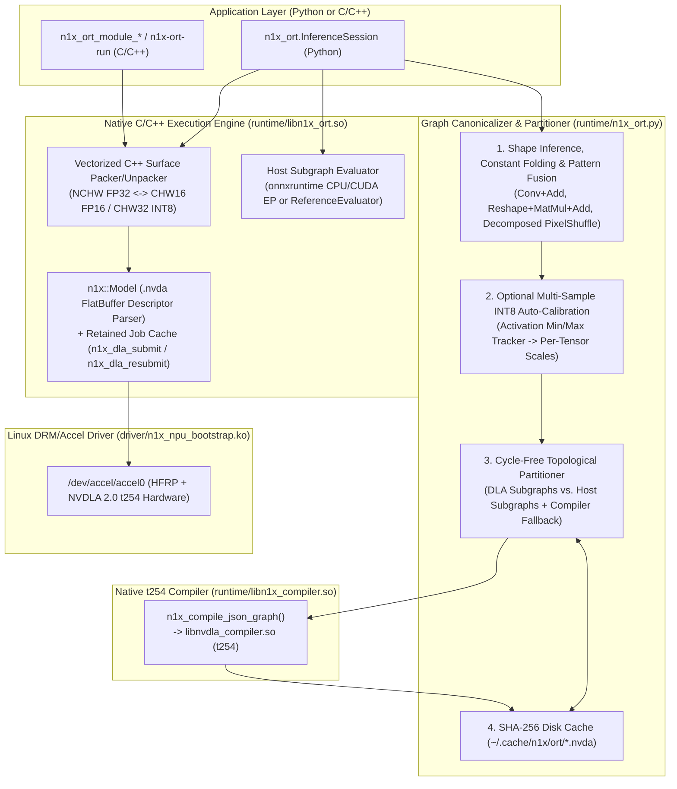

# N1X C-Backed Heterogeneous ONNX Execution Provider & Graph Partitioner

## Overview

This document specifies a C/C++-backed heterogeneous ONNX execution engine, graph partitioner, and `onnxruntime`-compatible execution provider (`libn1x_ort.so`, [`include/n1x_ort.h`](../../include/n1x_ort.h), and [`runtime/n1x_ort.py`](../../runtime/n1x_ort.py)) for the N1X NPU (`t254` Hummingbird). The engine accepts standard `.onnx` models, fuses multi-node ONNX patterns into canonical hardware layers, partitions arbitrary graphs into maximal NPU (`DLA`) subgraphs and host/GPU fallback subgraphs, compiles NPU subgraphs to `.nvda` loadables via [`libn1x_compiler.so`](../../runtime/n1x_compile.cpp), and executes the mixed schedule across `/dev/accel/accel0` and CPU/CUDA with automatic surface format conversion (`NCHW` FP32 $\leftrightarrow$ `CHW32`/`CHW16` FP16/INT8) at partition boundaries.

## The Problem

While [`libn1x_compiler.so`](../../include/n1x_compiler.h) and [`runtime/n1x_compiler.py`](../../runtime/n1x_compiler.py) compile branching DAGs and `INT8`/`FP16` networks directly to N1X `.nvda` loadables, running real-world `.onnx` models still requires manual graph surgery and manual buffer layout handling:

1. **Unfused ONNX Export Patterns**: Standard PyTorch and ONNX Model Zoo exports emit decomposed operator sequences that a 1:1 node importer rejects or executes suboptimally:
   - `mnist-12.onnx` exports convolution biases as standalone `Add(conv_out, Parameter[1, C, 1, 1])` nodes instead of the 3-input `Conv(X, W, B)` form, and exports the dense classifier head as `Reshape([1, 256])` $\rightarrow$ `MatMul([256, 10])` $\rightarrow$ `Add([1, 10])` instead of `Gemm`.
   - `super-resolution-10.onnx` exports its final $3\times$ sub-pixel upsampling stage (`DepthToSpace(blocksize=3)`) as a 5-node sequence (`Constant` $\rightarrow$ `Reshape([1, 1, 3, 3, 224, 224])` $\rightarrow$ `Transpose(perm=[0, 1, 4, 2, 5, 3])` $\rightarrow$ `Constant` $\rightarrow$ `Reshape([1, 1, 672, 672])`), forcing callers to pass `include_pixel_shuffle=False` and run the tail manually in NumPy.
2. **All-or-Nothing Compilation on Unsupported Operators**: When an ONNX graph contains even one operator unsupported by the NVDLA 2.0 (`t254`) hardware ISA (e.g., `Softmax`, `LayerNormalization`, `Gather`, `NonMaxSuppression`, general `Transpose`, or `Resize` with dynamic scales), whole-model compilation fails outright instead of offloading supported `Conv`/`BatchNorm`/`Relu`/`ElementWise`/`Pooling`/`FullyConnected`/`Concat`/`Scale` subgraphs to the NPU and executing the remaining operators on the host CPU or CUDA GPU.
3. **Manual Surface Layout Conversion at Boundaries**: Executing a compiled `.nvda` via [`libn1x_dla.so`](../../runtime/n1x_dla.h) or [`libnvcudla.so`](../../runtime/cudla_backend.cpp) requires callers to query `.nvda` tensor descriptors (`stride_0`, `stride_1`, `stride_2`, `data_type`, `data_format`) and manually pack/unpack between linear `NCHW` `float32` arrays and NPU-native `N1X_DLA_FORMAT_FEATURE` (`CHW16` FP16 / `CHW32` INT8) or `N1X_DLA_FORMAT_FEATURE_X8` (`CHW8` FP16) surfaces.
4. **Manual Post-Training Quantization (PTQ) Calibration**: Compiling an FP32 ONNX model to `INT8` currently requires the user to precompute a JSON calibration dictionary (`{"tensor_name": max_abs}`) or insert explicit `QuantizeLinear`/`DequantizeLinear` nodes before invoking the compiler.
5. **Lack of Standard C/C++ and Python Session APIs**: Applications written against `onnxruntime.InferenceSession` or native C/C++ inference loops have no unified session interface that compiles, caches, and dispatches partitioned `.onnx` models on N1X. Furthermore, [`packaging/arch/PKGBUILD`](../../packaging/arch/PKGBUILD) currently installs `n1x_npu_bootstrap.ko` and `n1x-npu-start` but omits `libn1x_dla.so`, `libn1x_compiler.so`, `n1x-compile`, and the execution provider headers/libraries.

## Goals

- **G1: Native C/C++ Heterogeneous Session & Surface Runtime (`libn1x_ort.so` + [`include/n1x_ort.h`](../../include/n1x_ort.h))**: Provide a C ABI and C++ execution engine (`N1xOrtModule`) that loads `.nvda` loadables, manages persistent `/dev/accel/accel0` hardware contexts and retained kernel jobs (`N1X_DLA_CAP_REEXEC_IO`), and performs vectorized (`NEON` FP16/INT8) surface packing and unpacking (`NCHW` FP32 $\leftrightarrow$ `CHW32`/`CHW16`/`CHW8` FP16/INT8) in C++.
- **G2: Canonical ONNX Graph Fusion & Lowering**: Automatically fuse and canonicalize multi-node ONNX patterns prior to partitioning:
  - `Conv` + constant channel-broadcast `Add` (`[1, C, 1, 1]` or `[C]`) $\rightarrow$ biased `Convolution`.
  - `MatMul` + constant `Add`, and `Flatten`/`Reshape(2D)` (following known spatial shape `[N, C, H, W]`) + constant `MatMul` (+ optional `Add`) $\rightarrow$ `FullyConnected` with weight reshaping (`[C*H*W, K]` transposed and reshaped to `[K, C, H, W]`).
  - `DepthToSpace(blocksize=r, mode="DCR")` and its decomposed 5-node `Reshape([N, C, r, r, H, W])` $\rightarrow$ `Transpose([0, 1, 4, 2, 5, 3])` $\rightarrow$ `Reshape([N, C, H*r, W*r])` pattern $\rightarrow$ `DepthToSpace` (`PixelShuffle` or automatic host fallback).
  - Constant-folding of shape/parameter subgraphs (`Reshape` on constant weights or `Shape` $\rightarrow$ `Gather` $\rightarrow$ `Unsqueeze` $\rightarrow$ `Concat` chains) when input shapes are static.
- **G3: Cycle-Free Topological Graph Partitioner**: Partition arbitrary static-shape ONNX graphs into an ordered schedule of `DLA` subgraphs (compiled to `.nvda` loadables) and `Host` subgraphs (`CPU`/`CUDA` fallback), guaranteeing:
  - Acyclic inter-partition dependencies via topological coarsening (preventing `DLA_0` $\rightarrow$ `Host_0` $\rightarrow$ `DLA_0` deadlocks).
  - Minimum subgraph threshold controls (`min_dla_ops`, default `1`) and operator blocklists (`fallback_ops`) for debugging and profiling.
  - Persistent disk caching of compiled `.nvda` subgraphs keyed by a SHA-256 digest of the canonical subgraph topology, weights, precision mode, and calibration ranges (`~/.cache/n1x/ort/` or an explicit `cache_dir` session option).
- **G4: `onnxruntime.InferenceSession`-Compatible Python API ([`runtime/n1x_ort.py`](../../runtime/n1x_ort.py))**: Provide `N1xInferenceSession` (and a drop-in `n1x_ort.InferenceSession` alias accepting `providers=["N1xExecutionProvider", "CPUExecutionProvider"]` with `provider_options`), using `onnxruntime` for host fallback subgraphs when installed and `onnx.reference.ReferenceEvaluator` when running in a minimal `onnx`+`numpy` environment.
- **G5: Built-In Multi-Sample `INT8` Auto-Calibration (PTQ)**: Support automatic post-training quantization directly in the session/partitioner workflow: given a calibration data iterable (or synthetic calibration generator), execute the model on the reference evaluator, record per-tensor activation dynamic ranges across all intermediate tensors, and compile the `DLA` subgraphs in `INT8` mode (`per_kernel` weights + calibrated activation scales).
- **G6: System Packaging (`packaging/arch/PKGBUILD` & `Makefile`)**: Build `runtime/libn1x_ort.so` and `runtime/n1x-ort-run` in [`Makefile`](../../Makefile) and update [`packaging/arch/PKGBUILD`](../../packaging/arch/PKGBUILD) to package `libn1x_dla.so`, `libn1x_compiler.so`, `libn1x_ort.so`, `n1x-compile`, `n1x-ort-run`, headers (`n1x_dla.h`, `n1x_compiler.h`, `n1x_ort.h`), and Python runtime modules.

## Non-Goals

- **Dynamic Shape Compilation at Inference Time**: `libnvdla_compiler.so` (`t254`) compiles static spatial and channel dimensions (`N=1, C, H, W`) into fixed hardware address descriptors. Dynamic axes (`batch_size` or symbolic `H`/`W`) must be bound via `input_shapes` at session creation time; dynamic re-compilation on every inference call is out of scope.
- **Training / Backward Pass Execution**: The N1X NPU is an inference-only fixed-function/LUT accelerator; backward pass / gradient operators are out of scope.
- **Forking Upstream `onnxruntime` C++ Repository**: Building a monolithic `libonnxruntime.so` from a 2+ GB upstream C++ source tree is unnecessary. `libn1x_ort.so` provides a standalone C ABI and `runtime/n1x_ort.py` provides the Python `InferenceSession` interface.

## Open Questions

None. All architectural decisions were resolved during Step 1 (`A, C-Backed` selected).

## Critical User Journeys (CUJs)

### CUJ 1: Zero-Surgery Python Execution of Unmodified Model Zoo ONNX Files (`mnist-12.onnx` & `super-resolution-10.onnx`)
A developer loads unmodified `mnist-12.onnx` or `super-resolution-10.onnx` using `N1xInferenceSession`:
```python
from n1x_ort import InferenceSession

sess = InferenceSession(
    "sources/demo-research/super-resolution-10.onnx",
    providers=["N1xExecutionProvider", "CPUExecutionProvider"],
)
outputs = sess.run(None, {"input": img_nchw_fp32})
```
For `mnist-12.onnx`, the graph canonicalizer fuses `Conv+Add` into biased `Convolution` and `Reshape+MatMul+Add` into `FullyConnected`, compiling 100% of the network into a single `DLA` subgraph (`.nvda`) executed on `/dev/accel/accel0`. For `super-resolution-10.onnx`, the 4 `Conv`/`Relu` feature layers compile into a `DLA` subgraph (`input` $\rightarrow$ `'15'`) and the trailing 5-node sub-pixel reshape/transpose sequence executes either as a fused `PixelShuffle` layer or as a `Host` fallback stage, returning the `[1, 1, 672, 672]` `float32` output without manual graph slicing.

### CUJ 2: Heterogeneous Execution of a Model with Unsupported Mid/Tail Operators (`INT8` Auto-Calibrated)
A developer passes an ONNX classification or detection model containing `Conv`/`BatchNorm`/`Relu`/`Add` backbones followed by `GlobalAveragePool` $\rightarrow$ `Flatten` $\rightarrow$ `Gemm` $\rightarrow$ `Softmax` (or an unsupported `LayerNormalization` / `Resize` block), along with 10 calibration inputs:
```python
sess = InferenceSession(
    "resnet_block_softmax.onnx",
    providers=[("N1xExecutionProvider", {
        "precision": "int8",
        "calibration_data": calib_batches,
        "cache_dir": "/tmp/n1x_cache",
    }), "CPUExecutionProvider"],
)
probs = sess.run(None, {"input": test_batch})[0]
```
The partitioner runs the calibration batches through the graph to collect per-tensor activation ranges, compiles the backbone + `Gemm` into an `INT8` `.nvda` subgraph, caches the compiled binary on disk, executes the `INT8` subgraph on `/dev/accel/accel0` with C++-accelerated `NCHW` FP32 $\leftrightarrow$ `CHW32` INT8 layout conversion, and runs the trailing `Softmax` on the host provider.

### CUJ 3: Native C/C++ Inference & Layout Packing via `libn1x_ort.so` and `n1x-ort-run`
A C/C++ application (or the `runtime/n1x-ort-run` CLI tool) loads an `.nvda` module using [`include/n1x_ort.h`](../../include/n1x_ort.h) and submits standard contiguous `NCHW` `float32` buffers directly:
```c
N1xOrtModule *mod = NULL;
char err[256];
n1x_ort_module_create_from_file("mnist.nvda", -1, &mod, err, sizeof(err));
n1x_ort_module_run_fp32(mod, &input_fp32_ptr, &in_elems, 1, &output_fp32_ptr, &out_elems, 1, err, sizeof(err));
n1x_ort_module_destroy(mod);
```
Inside `libn1x_ort.so`, C++ routines inspect the `.nvda` surface descriptors, convert `NCHW` `float32` inputs into padded `CHW16` FP16 or `CHW32` INT8 GEM buffers using ARMv8.2-A FP16/SIMD instructions, submit the hardware task to `/dev/accel/accel0`, and unpack the output surface back to contiguous `NCHW` `float32`.

## Technical Plan

### Architecture Overview

The execution provider splits responsibilities across two layers:
1. **Graph Canonicalizer, Partitioner & Plan Builder ([`runtime/n1x_ort.py`](../../runtime/n1x_ort.py) + [`runtime/n1x_compiler.py`](../../runtime/n1x_compiler.py))**: Performs static shape inference, constant folding, multi-node pattern fusion (`Conv+Add`, `Flatten+MatMul+Add`, `Reshape+Transpose+Reshape`), multi-sample `INT8` PTQ calibration, cycle-free topological partitioning into `DLA` and `Host` subgraphs, SHA-256 disk caching (`~/.cache/n1x/ort/`), and `.nvda` compilation via [`libn1x_compiler.so`](../../include/n1x_compiler.h).
2. **Native C/C++ Execution & Surface Runtime ([`runtime/libn1x_ort.so`](../../runtime/n1x_ort.cpp) + [`include/n1x_ort.h`](../../include/n1x_ort.h))**: Parses `.nvda` flatbuffer descriptors via [`n1x::Model`](../../runtime/cudla_model.hpp), converts contiguous `NCHW` `float32` tensors to and from hardware-strided `CHW16` FP16 and `CHW32`/`CHW16` INT8 surfaces in C++ using ARM64 FP16/SIMD routines, and executes `DLA` stages on `/dev/accel/accel0` via [`libn1x_dla.so`](../../runtime/n1x_dla.h) using retained kernel jobs (`N1X_DLA_CAP_REEXEC_IO` + [`n1x_dla_resubmit`](../../runtime/n1x_dla.h)).



---

### Stage 1: ONNX Graph Canonicalization & Pattern Fusion

Before partitioning or lowering to the N1X JSON DAG format, `canonicalize_onnx_model(model, input_shapes)` transforms the `onnx.ModelProto` in memory through five deterministic passes:

1. **Static Input Shape Binding & Shape Inference**:
   - Replaces symbolic or dynamic input dimensions (`dim_param` or `dim_value <= 0`) with concrete dimensions from `input_shapes` (defaulting batch dimension `d[0] = 1`) and runs `onnx.shape_inference.infer_shapes(model)`.
2. **Constant Folding of Initializer & Shape Subgraphs**:
   - Evaluates any node whose inputs are all initializers or `Constant` outputs (such as `Reshape(Parameter193, shape=[256, 10])` in `mnist-12.onnx`, or `Shape` $\rightarrow$ `Gather` $\rightarrow$ `Unsqueeze` $\rightarrow$ `Concat` chains that compute static `Reshape` target shapes) using `onnx.reference.ReferenceEvaluator`, promoting the folded result into `graph.initializer` and pruning dead producer nodes.
3. **`Conv` / `ConvTranspose` + Constant `Add` Bias Fusion**:
   - Matches `Conv(X, W)` (2 inputs, no bias) followed by `Add(conv_out, B_const)` (or `Add(B_const, conv_out)`) where `conv_out` has a single consumer and `B_const` is a constant tensor broadcastable to `[1, C_out, 1, 1]` (i.e. shape `[C_out]`, `[1, C_out, 1, 1]`, or `[C_out, 1, 1]` as in `mnist-12.onnx`).
   - Reshapes `B_const` to 1D `[C_out]` and attaches it as the 3rd input of `Conv(X, W, B_flat)`, eliminating the standalone `Add` node.
4. **Spatial `Flatten`/`Reshape` + `MatMul` + `Add` $\rightarrow$ `Gemm` / `FullyConnected` Fusion**:
   - Matches `Flatten(X_4d)` or `Reshape(X_4d)` $\rightarrow$ `MatMul(flat_out, W_2d)` ($\rightarrow$ optional `Add(mm_out, B_1d)`) where `X_4d` has static 4D shape `[1, C, H, W]` with $C \cdot H \cdot W = K_{\text{in}}$ and `W_2d` is a constant initializer of shape $[K_{\text{in}}, K_{\text{out}}]$.
   - When lowering to the N1X JSON DAG, [`runtime/n1x_compile.cpp`](../../runtime/n1x_compile.cpp) expects `FullyConnected` input tensors to carry their pre-flattened 4D spatial dimensions `[1, C, H, W]` and sets the NVDLA weight blob dimensions to `{K_out, C, H, W}`. Transposing `W_2d` from $[C \cdot H \cdot W, K_{\text{out}}]$ to $[K_{\text{out}}, C \cdot H \cdot W]$ places the weights in exact row-major `[K_out, C, H, W]` order, allowing the `Reshape`/`Flatten` node to be bypassed and the optional `Add` bias `[1, K_out]` to be fused into `FullyConnected.bias_b64`.
5. **Decomposed Sub-Pixel Convolution (`Reshape` $\rightarrow$ `Transpose` $\rightarrow$ `Reshape`) Recognition**:
   - Matches the 5-node opset-10 sub-pixel pattern in `super-resolution-10.onnx`:
     `Reshape(X, [1, C_out, r, r, H, W])` $\rightarrow$ `Transpose(perm=[0, 1, 4, 2, 5, 3])` $\rightarrow$ `Reshape(_, [1, C_out, H*r, W*r])`
     and rewrites it into a single `DepthToSpace(X, blocksize=r, mode="DCR")` node so the partitioner can treat it atomically (either lowered to `PixelShuffle` on `DLA` or dispatched as a single stage to `Host`).

---

### Stage 2: Cycle-Free Topological Graph Partitioner & Compiler-Verified Fallback

Given a canonicalized `onnx.ModelProto`, the partitioner assigns each node in topological order to either `DLA` or `Host` and groups contiguous compatible nodes into an ordered list of `ExecutionStage` objects:

#### Operator Capability Predicate (`is_node_dla_supported`)
A node is eligible for `DLA` placement if and only if:
1. Its input and output tensors have known static shapes with batch size `N == 1`, and its `op_type` is not in the caller's `fallback_ops` set.
2. Its `op_type` belongs to the supported NVDLA 2.0 (`t254`) operator table and satisfies hardware parameter bounds:
   - `Conv`, `ConvTranspose`: 2D spatial (`4D` tensor), constant weight/bias initializers, `1 <= kernel_h, kernel_w <= 32`, `1 <= stride_h, stride_w <= 8`, `1 <= dilation_h, dilation_w <= 8`, `1 <= C_in, C_out <= 8192`.
   - `Gemm`, `MatMul`: constant 2D weight initializer, `alpha == 1.0`, `beta in (0.0, 1.0)`, `transA == 0`.
   - `Relu`, `Sigmoid`, `Tanh`, `Clip`, `LeakyRelu`: `4D` or `2D` (promoted to `[1, C, 1, 1]`) input.
   - `MaxPool`, `AveragePool`, `GlobalAveragePool`: 2D spatial, `1 <= window_h, window_w <= 8` (or full `H x W` for `GlobalAveragePool` when `H, W <= 8`), `ceil_mode == 0`.
   - `Add`, `Sub`, `Mul`, `Max`, `Min`: either binary elementwise with identical `4D` shapes, or `Add`/`Mul` with a constant per-channel/scalar initializer (lowered to `Scale`).
   - `BatchNormalization`: training mode disabled (`len(node.output) == 1`), constant `scale`, `B`, `mean`, `var` initializers.
   - `Concat`: `axis == 1` (channel concatenation) over `4D` tensors with identical `(N, H, W)`.
   - `DepthToSpace`: `mode == "DCR"` (default), `blocksize >= 2`, only when `enable_dla_pixel_shuffle=True`.
   - `QuantizeLinear`, `DequantizeLinear`: constant scale/zero-point initializers.
   - Zero-cost shape/alias operators (`Identity`, `Dropout`, `Flatten`, `Reshape`, `Squeeze`, `Unsqueeze`): eligible for `DLA` placement only when their input and consumer remain compatible with the `DLA` 4D tensor representation (e.g., `Flatten`/`Reshape` immediately feeding a fused `FullyConnected` node, or no-op `Identity`). Standalone arbitrary 5D/6D `Reshape` or non-noop `Transpose` nodes are placed on `Host`.

#### Cycle-Free Partitioning Algorithm
To guarantee that no `DLA` partition depends on a `Host` partition that itself depends on the same `DLA` partition:
1. Compute a topological ordering of `graph.node` (`n_0, n_1, ..., n_{m-1}`).
2. Assign an integer stage index `stage_id[node]` monotonically along the topological order:
   - Maintain the current stage `(current_kind, current_nodes)`.
   - For the next node $u$ in topological order with target kind $k(u) \in \{\text{DLA}, \text{Host}\}$:
     - If $k(u) == \text{current\_kind}$ and adding $u$ to `current_nodes` does not create a dependency on any node outside `already_scheduled_in_prior_stages` $\cup$ `current_nodes`, append $u$ to `current_nodes`.
     - Otherwise, close `current_nodes` (if `current_kind == DLA` and the count of compute ops is `< min_dla_ops`, demote `current_nodes` to `Host` and merge with the adjacent `Host` stage) and start a new stage with $u$.
3. **Compiler-Verified Fallback**:
   - For each `DLA` stage, extract its induced ONNX subgraph (`inputs` = tensors produced outside the stage, `outputs` = tensors consumed by later stages or `graph.output`), lower it via `onnx_to_dag`, and invoke `compile_dag` (or load from the SHA-256 disk cache).
   - If `libnvdla_compiler.so` returns a compilation error on a multi-node `DLA` stage (for instance, due to an internal `t254` engine constraint on a tail `PixelShuffle` or large `GlobalAveragePool`), the partitioner peels off the failing boundary node(s) to a `Host` stage and compiles the remaining `DLA` core.

---

### Stage 3: Native C ABI ([`include/n1x_ort.h`](../../include/n1x_ort.h)) and C++ Surface/Execution Runtime (`runtime/libn1x_ort.so`)

`runtime/libn1x_ort.so` links [`runtime/cudla_model.cpp`](../../runtime/cudla_model.cpp), [`runtime/libn1x_dla.so`](../../runtime/n1x_dla.h), and [`runtime/libn1x_compiler.so`](../../include/n1x_compiler.h). It exposes a self-contained C ABI in [`include/n1x_ort.h`](../../include/n1x_ort.h):

```c
/* SPDX-License-Identifier: MIT */
#ifndef N1X_ORT_H
#define N1X_ORT_H

#include <stddef.h>
#include <stdint.h>

#ifdef __cplusplus
extern "C" {
#endif

typedef struct N1xOrtModule N1xOrtModule;

typedef struct N1xOrtTensorDesc {
    char name[64];
    uint64_t size;          /* Total bytes in hardware surface */
    uint32_t n;
    uint32_t c;
    uint32_t h;
    uint32_t w;
    uint8_t data_format;    /* 3 = FEATURE (CHW16), 4 = FEATURE_X8 (CHW8), 5 = FEATURE (CHW32 INT8) */
    uint8_t data_type;      /* 2 = FP16, 4 = INT8 */
    uint8_t data_category;
    uint8_t pixel_format;   /* 36 = FEATURE_X32 */
    uint8_t pixel_mapping;
    uint8_t reserved[3];
    uint32_t stride[8];     /* stride[0]=elem_bytes, stride[1]=line_bytes, stride[2]=surface_bytes */
} N1xOrtTensorDesc;

/* Load an .nvda binary from memory or file path and optionally bind to /dev/accel/accel0 (fd >= 0).
 * Passing fd < 0 opens /dev/accel/accel0 automatically when n1x_ort_module_run_fp32 is called,
 * while still allowing offline descriptor queries and surface packing without hardware present.
 */
int n1x_ort_module_create(const uint8_t *nvda_bytes, size_t nvda_size,
                          int accel_fd, N1xOrtModule **out_module,
                          char *err_buf, size_t err_buf_len);

int n1x_ort_module_create_from_file(const char *nvda_path, int accel_fd,
                                    N1xOrtModule **out_module,
                                    char *err_buf, size_t err_buf_len);

void n1x_ort_module_destroy(N1xOrtModule *module);

size_t n1x_ort_module_num_inputs(const N1xOrtModule *module);
size_t n1x_ort_module_num_outputs(const N1xOrtModule *module);
int n1x_ort_module_get_input_desc(const N1xOrtModule *module, size_t index,
                                  N1xOrtTensorDesc *out_desc);
int n1x_ort_module_get_output_desc(const N1xOrtModule *module, size_t index,
                                   N1xOrtTensorDesc *out_desc);

/* Configure optional per-input / per-output INT8 quantization scales (float32, length 1 or C)
 * and zero-points (int8, length 1 or C). Default scale is 1.0f, zero-point 0.
 */
int n1x_ort_module_set_input_quant(N1xOrtModule *module, size_t index,
                                   const float *scales, size_t num_scales,
                                   const int8_t *zero_points, size_t num_zps);

int n1x_ort_module_set_output_quant(N1xOrtModule *module, size_t index,
                                    const float *scales, size_t num_scales,
                                    const int8_t *zero_points, size_t num_zps);

/* Vectorized C++ NCHW float32 <-> NPU surface conversion (usable offline or online). */
int n1x_ort_pack_fp32(const N1xOrtTensorDesc *desc,
                      const float *nchw_fp32, size_t num_elements,
                      const float *scales, size_t num_scales,
                      const int8_t *zero_points, size_t num_zps,
                      uint8_t *out_surface, size_t out_surface_bytes);

int n1x_ort_unpack_fp32(const N1xOrtTensorDesc *desc,
                        const uint8_t *surface, size_t surface_bytes,
                        const float *scales, size_t num_scales,
                        const int8_t *zero_points, size_t num_zps,
                        float *out_nchw_fp32, size_t num_elements);

/* Execute the .nvda module on /dev/accel/accel0 with contiguous NCHW float32 inputs/outputs.
 * Automatically packs inputs into the staging image, uses n1x_dla_submit on first call and
 * n1x_dla_resubmit (retained kernel job) on subsequent calls when N1X_DLA_CAP_REEXEC_IO is
 * supported, reads back outputs, and unpacks to contiguous NCHW float32.
 */
int n1x_ort_module_run_fp32(N1xOrtModule *module,
                            const float *const *inputs_fp32, const size_t *input_elem_counts, size_t num_inputs,
                            float *const *outputs_fp32, const size_t *output_elem_counts, size_t num_outputs,
                            char *err_buf, size_t err_buf_len);

#ifdef __cplusplus
}
#endif

#endif /* N1X_ORT_H */
```

#### Vectorized C++ Surface Packing & Retained-Job Execution (`runtime/n1x_ort.cpp`)
- **Surface Packing (`n1x_ort_pack_fp32`) & Unpacking (`n1x_ort_unpack_fp32`)**:
  - Validates that all input `float` values are finite (`std::isfinite`).
  - Determines `group_channels` from `(data_format, data_type, pixel_format)`:
    - `data_type == 2` (`FP16`), `data_format == 3`: `group_channels = 16`, element type `__fp16` (`uint16_t` IEEE-754 binary16).
    - `data_type == 2` (`FP16`), `data_format == 4`: `group_channels = 8`, element type `__fp16`.
    - `data_type == 4` (`INT8`), `data_format == 5` or `pixel_format == 36`: `group_channels = 32`, element type `int8_t`.
    - `data_type == 4` (`INT8`), `data_format == 3`: `group_channels = 16`, element type `int8_t`.
  - Computes target byte offset for `(c, y, x)`:
    $$\text{offset}(c, y, x) = \lfloor c / G \rfloor \cdot \text{stride}_2 + y \cdot \text{stride}_1 + x \cdot (G \cdot \text{stride}_0) + (c \bmod G) \cdot \text{stride}_0$$
    where $G = \text{group\_channels}$.
  - On ARM64 (`__aarch64__`), converts `float` $\leftrightarrow$ `__fp16` using native hardware `fcvt` instructions (`_Float16` / `__fp16`) and `INT8` using `std::nearbyint(val / scale + zp)` clamped to `[-128, 127]`.
- **Retained Kernel Job Lifecycle**:
  - `N1xOrtModule` holds a pre-materialized staging copy of `model.image` (`std::vector<uint8_t> staging_image`) and `uint64_t retained_job_id = 0`.
  - On the first `n1x_ort_module_run_fp32` call, `n1x_ort_pack_fp32` writes directly into `staging_image.data() + tensor.offset` for each input tensor, zeroes/marks output tensor slices, and calls `n1x_dla_submit_flags(fd, staging_image.data(), staging_image.size(), ranges, num_ranges, writable, num_writable, N1X_DLA_SUBMIT_RETAIN, &result)`.
  - On subsequent calls, if `retained_job_id != 0`, it packs the new inputs into `staging_image` and calls `n1x_dla_resubmit(fd, retained_job_id, patches, num_patches, &result)`, updating only the input/output tensor slices in kernel GEM memory without re-transferring weights or firmware descriptors.
  - On `n1x_ort_module_destroy`, if `retained_job_id != 0` and `fd >= 0`, it calls `n1x_dla_control(fd, retained_job_id, N1X_DLA_CONTROL_RELEASE, &ctrl)` before closing the file descriptor (if owned).

---

### Stage 4: Python `InferenceSession` & Multi-Sample `INT8` Auto-Calibration ([`runtime/n1x_ort.py`](../../runtime/n1x_ort.py))

[`runtime/n1x_ort.py`](../../runtime/n1x_ort.py) provides `N1xInferenceSession` (aliased as `InferenceSession`):

```python
class N1xInferenceSession:
    def __init__(
        self,
        path_or_bytes: str | Path | bytes | onnx.ModelProto,
        sess_options: Any = None,
        providers: Sequence[str | tuple[str, dict[str, Any]]] | None = None,
        provider_options: Sequence[dict[str, Any]] | None = None,
        **kwargs: Any,
    ) -> None: ...

    def get_inputs(self) -> list[N1xNodeArg]: ...
    def get_outputs(self) -> list[N1xNodeArg]: ...
    def get_providers(self) -> list[str]: ...
    def get_partition_summary(self) -> dict[str, Any]: ...
    def run(
        self,
        output_names: Sequence[str] | None,
        input_feed: Mapping[str, np.ndarray],
        run_options: Any = None,
    ) -> list[np.ndarray]: ...
```

#### Supported `N1xExecutionProvider` Options
| Option Key | Type | Default | Description |
|---|---|---|---|
| `precision` | `"fp16"` \| `"int8"` | `"fp16"` | Target compute precision for `DLA` subgraphs. |
| `calibration` | `dict[str, Any]` \| `None` | `None` | Precomputed tensor dynamic range map (`{"tensor_name": max_abs}`). |
| `calibration_data` | `Iterable[Mapping[str, np.ndarray]]` \| `None` | `None` | Sample input feeds used to automatically calibrate all intermediate tensor ranges when `precision == "int8"`. |
| `input_shapes` | `dict[str, list[int]]` \| `None` | `None` | Static shape overrides for symbolic/dynamic model inputs. |
| `cache_dir` | `str` \| `Path` \| `None` | `~/.cache/n1x/ort` | Directory for SHA-256 cached `.nvda` subgraph binaries (`None` or `""` disables caching). |
| `device_path` | `str` | `"/dev/accel/accel0"` | Path to the N1X DRM/accel device node. |
| `min_dla_ops` | `int` | `1` | Minimum number of compute nodes required to form a `DLA` subgraph. |
| `fallback_ops` | `Sequence[str]` | `()` | ONNX `op_type` names forced onto the `Host` provider. |
| `enable_dla_pixel_shuffle` | `bool` | `False` | Whether `DepthToSpace` / decomposed sub-pixel convolution is attempted on `DLA` before falling back to `Host`. |

#### Multi-Sample `INT8` Auto-Calibration (`calibrate_onnx_model`)
When `precision == "int8"` and `calibration is None`:
1. Construct an instrumenting `onnx.ModelProto` where every intermediate node output in the canonicalized graph is appended to `graph.output`.
2. Execute the instrumented model over `calibration_data` (or, if `calibration_data` is omitted, 4 deterministic pseudo-random normal inputs seeded with `0`) using `onnxruntime.InferenceSession(..., providers=["CPUExecutionProvider"])` if `onnxruntime` is installed, or `onnx.reference.ReferenceEvaluator` otherwise.
3. Track the running maximum absolute value $M_t = \max_{\text{samples}} \|\text{tensor}_t\|_\infty$ for every graph input, intermediate activation, and output tensor (flooring $M_t$ at `1e-5` to prevent zero scale):
   $$s_t = \frac{M_t}{127.0}$$
4. For each `DLA` stage:
   - Pass the stage's subset of `calibration` (`{"tensor_ranges": {name: M_t}}`) into `onnx_to_dag(..., compute_precision="int8", calibration=stage_calib)`.
   - Call `n1x_ort_module_set_input_quant` and `n1x_ort_module_set_output_quant` on the stage's `N1xOrtModule` with $s_t = M_t / 127.0$ so `n1x_ort_module_run_fp32` automatically quantizes `float32` stage inputs to `CHW32` `INT8` and dequantizes `CHW32` `INT8` stage outputs back to `float32`.

## Alternatives Considered

### Alternative 1: C-Backed Heterogeneous ONNX Partitioner & Execution Provider (`A, C-Backed` — Chosen)
- **Description**: Implement a standalone C/C++ surface and module execution runtime (`runtime/libn1x_ort.so` + [`include/n1x_ort.h`](../../include/n1x_ort.h)) on top of [`n1x::Model`](../../runtime/cudla_model.hpp) and [`libn1x_dla.so`](../../runtime/n1x_dla.h), paired with an `onnxruntime.InferenceSession`-compatible Python partitioner and session manager ([`runtime/n1x_ort.py`](../../runtime/n1x_ort.py)).
- **Pros**:
  - Compiles in seconds with the system C++17 toolchain without fetching a 2+ GB upstream `onnxruntime` C++ source tree.
  - Moves hot-path `NCHW` `float32` $\leftrightarrow$ `CHW16` FP16 / `CHW32` INT8 layout conversion and `n1x_dla_resubmit` retained-job management into compiled C++ (`libn1x_ort.so`), usable from both C/C++ (`runtime/n1x-ort-run`) and Python (`runtime/n1x_ort.py`).
  - Works out-of-the-box with `onnx` + `numpy` (`ReferenceEvaluator`) and automatically upgrades host subgraphs to `onnxruntime` (`CPUExecutionProvider` / `CUDAExecutionProvider`) when `onnxruntime` is installed.
- **Cons**:
  - Does not register a binary `IExecutionProvider` shared library inside an unmodified upstream C++ `libonnxruntime.so` process (which has no stable cross-version C++ plugin ABI).

### Alternative 2: Full Upstream C++ `onnxruntime::IExecutionProvider` Fork (`B`)
- **Description**: Fork the upstream Microsoft `onnxruntime` repository, implement a C++ `N1xExecutionProvider : public IExecutionProvider` subclass inside `onnxruntime/core/providers/n1x/`, and compile a custom `libonnxruntime.so` and Python wheel.
- **Pros**:
  - Integrates directly with `onnxruntime`'s internal C++ `GraphViewer` and `GetCapability` APIs.
- **Cons**:
  - `onnxruntime`'s internal C++ `IExecutionProvider` interface is explicitly unstable across point releases and requires building the entire `onnxruntime` C++ tree (thousands of translation units, protobuf/eigen/abseil dependencies).
  - Couples our lightweight kernel/runtime repository (`/home/johann/p16/n1x-lab/npu`) to a multi-gigabyte external build system.

### Alternative 3: Pure-Python Surface Packing & Per-Call Job Submission (`C`)
- **Description**: Implement graph partitioning in Python (`runtime/n1x_ort.py`) and reuse the existing Python `_pack_grouped` / `_unpack_grouped` channel loops and single-shot `Device.submit()` in [`runtime/n1x_dla.py`](../../runtime/n1x_dla.py) without a C/C++ `libn1x_ort.so` runtime.
- **Pros**:
  - Minimal C++ code to write.
- **Cons**:
  - Python `for ch in range(channels):` strided slice loops in [`runtime/n1x_dla.py`](../../runtime/n1x_dla.py) and fresh 2.8 MB `.nvda` image uploads on every `submit()` call add millisecond-level host overhead per subgraph transition, dominating the sub-millisecond NPU execution time.
  - Provides no C/C++ inference API for native applications.

### Decision Matrix

| Criterion | Alt 1: `A, C-Backed` (Chosen) | Alt 2: Upstream ORT C++ Fork (`B`) | Alt 3: Pure-Python Loop (`C`) |
|---|---|---|---|
| Build Time & External Dependencies | < 3 s (`g++ -O2`), zero new deps | 45–90 min (`cmake` + 2 GB source tree) | 0 s |
| C/C++ Application ABI (`include/n1x_ort.h`) | Yes (`libn1x_ort.so` + `n1x-ort-run`) | Only via full `libonnxruntime.so` | No |
| Surface Conversion & Resubmit Speed | Native C++ FP16/INT8 + `n1x_dla_resubmit` | Native C++ | Slow Python channel loops + full image upload |
| Works Without `onnxruntime` Installed | Yes (`onnx.reference.ReferenceEvaluator` fallback) | No | Yes |

---

## Non-Functional Requirements

### Performance & Latency
- **Retained Kernel Job Re-Execution (`N1X_DLA_CAP_REEXEC_IO`)**: After the initial `n1x_dla_submit_flags(..., N1X_DLA_SUBMIT_RETAIN, ...)` call uploads the `.nvda` instruction/weight image to kernel GEM memory, subsequent `n1x_ort_module_run_fp32` invocations use `n1x_dla_resubmit` to patch only the input and output tensor slices (typically 1–200 KiB instead of 2.8–3.2 MiB).
- **Vectorized C++ Surface Conversion**: `n1x_ort_pack_fp32` and `n1x_ort_unpack_fp32` are compiled with `-O2` on `aarch64`, using native hardware `_Float16` (`fcvt`) conversions and contiguous pixel-group stores instead of Python per-channel strided NumPy views.
- **SHA-256 `.nvda` Disk Cache**: Compiling a subgraph via `libnvdla_compiler.so` takes ~80–250 ms. Caching compiled `.nvda` blobs under `~/.cache/n1x/ort/<sha256>.nvda` reduces warm session initialization to a < 2 ms file read.

### Security & Safety
- **Checked FlatBuffer & Bounds Validation**: `libn1x_ort.so` reuses [`n1x::Model`](../../runtime/cudla_model.cpp), which enforces a 64 MiB `.nvda` file limit, a 32 MiB materialized image limit, bounded metadata traversal budgets (`records = 65536`), and strict extent verification (`offset + bytes <= capacity`) before allocating staging memory.
- **Non-Finite Input & Output Rejection**: Both `n1x_ort_pack_fp32` and `n1x_ort_unpack_fp32` reject `NaN` and `±Inf` values with `-EINVAL` to prevent silent corruption across `DLA` $\leftrightarrow$ `Host` partition boundaries.
- **No Automatic Hardware Retry**: In compliance with [`runtime/n1x_dla.h`](../../runtime/n1x_dla.h), `libn1x_ort.so` never retries a failed `n1x_dla_submit_flags` or `n1x_dla_resubmit` ioctl automatically.

### Observability & Diagnostics
- **`get_partition_summary()`**: `N1xInferenceSession.get_partition_summary()` returns a structured dictionary containing:
  - `num_stages`, `dla_stages`, `host_stages`
  - Per-stage metadata: `stage_id`, `kind` (`"DLA"` or `"Host"`), `ops` (list of `(op_type, node_name)`), `inputs`, `outputs`, `precision` (`"fp16"` or `"int8"`), `nvda_bytes`, and `cache_hit` (`bool`).
- **`runtime/n1x-ort-run` CLI**: Prints module input/output tensor descriptors (`N, C, H, W`, `data_format`, `data_type`, `strides`), execution status, and summary output statistics (`min`, `max`, `mean`, `l2_norm`).

## Detailed Implementation Plan

### Phase 1: Native C/C++ Surface & Module Runtime (`include/n1x_ort.h`, `runtime/n1x_ort.cpp`, `runtime/n1x-ort-run`)

1. **Create [`include/n1x_ort.h`](../../include/n1x_ort.h)**:
   - Define `N1xOrtModule` and `N1xOrtTensorDesc`.
   - Declare module lifecycle APIs (`n1x_ort_module_create`, `n1x_ort_module_create_from_file`, `n1x_ort_module_destroy`), descriptor introspection APIs (`n1x_ort_module_num_inputs`, `n1x_ort_module_num_outputs`, `n1x_ort_module_get_input_desc`, `n1x_ort_module_get_output_desc`), quantization configuration APIs (`n1x_ort_module_set_input_quant`, `n1x_ort_module_set_output_quant`), vectorized surface conversion APIs (`n1x_ort_pack_fp32`, `n1x_ort_unpack_fp32`), and hardware execution API (`n1x_ort_module_run_fp32`).
2. **Create [`runtime/n1x_ort.cpp`](../../runtime/n1x_ort.cpp)**:
   - Reuse [`n1x::Model`](../../runtime/cudla_model.hpp) from [`runtime/cudla_model.cpp`](../../runtime/cudla_model.cpp) to parse `.nvda` flatbuffer loadables into `image`, `ranges`, `inputs`, `outputs`, and `stats`.
   - Implement `n1x_ort_pack_fp32` and `n1x_ort_unpack_fp32` supporting:
     - `CHW16` `FP16` (`data_format=3, data_type=2, stride[0]=2`, `group_channels=16`) using ARM64 native `_Float16` (`__fp16`) conversion.
     - `CHW8` `FP16` (`data_format=4, data_type=2, stride[0]=2`, `group_channels=8`).
     - `CHW32` `INT8` (`data_format=5` or `pixel_format=36`, `data_type=4, stride[0]=1`, `group_channels=32`) with per-tensor (`num_scales == 1`) or per-channel (`num_scales == C`) `float32` scale and `int8` zero-point quantization/dequantization.
     - `CHW16` `INT8` (`data_format=3, data_type=4, stride[0]=1`, `group_channels=16`).
     - Strict `std::isfinite` verification on both input `float32` arrays and unpacked `float32` outputs.
   - Implement `n1x_ort_module_run_fp32`:
     - Lazily open `/dev/accel/accel0` (or `$N1X_DLA_DEVICE`) via [`n1x_dla_open`](../../runtime/n1x_dla.h) if `accel_fd < 0` was passed at module creation.
     - Pack `inputs_fp32[i]` into `staging_image.data() + inputs[i].offset`.
     - On initial execution, submit via [`n1x_dla_submit_flags`](../../runtime/n1x_dla.h) with `N1X_DLA_SUBMIT_RETAIN` when `info.capabilities & N1X_DLA_CAP_REEXEC_IO` is advertised and retain limits permit; on subsequent executions, submit via [`n1x_dla_resubmit`](../../runtime/n1x_dla.h) patching only input/output tensor slices.
     - Read output tensor slices via [`n1x_dla_read`](../../runtime/n1x_dla.h) and unpack into `outputs_fp32[i]`.
     - Release any retained job via [`n1x_dla_control`](../../runtime/n1x_dla.h) (`N1X_DLA_CONTROL_RELEASE`) inside `n1x_ort_module_destroy`.
   - Under `#ifdef N1X_ORT_CLI_MAIN`, provide a `main()` entry point for `runtime/n1x-ort-run` supporting `--inspect <model.nvda>` (offline descriptor printout) and `--run <model.nvda> [--input <in.bin>] [--output <out.bin>] [--repeat N]`.

### Phase 2: Canonical ONNX Graph Rewriter & Pattern Fusion ([`runtime/n1x_ort.py`](../../runtime/n1x_ort.py) & [`runtime/n1x_compiler.py`](../../runtime/n1x_compiler.py))

1. **Extend [`runtime/n1x_compiler.py`](../../runtime/n1x_compiler.py)**:
   - Update `onnx_to_dag` (`L376-L399`) so `Gemm`/`MatMul` (`FullyConnected`) accepts both 4D spatial inputs (`[1, C, H, W]`) and 2D flattened inputs (`[1, K_in]` aliased back to its pre-flattened 4D producer `[1, C, H, W]`), and fuses an optional 3rd bias input (`node.input[2]`) into `bias_b64` (`bias_mode="channel"`).
   - Ensure `Add`/`Sub`/`Mul`/`Max`/`Min` (`L452-L485`) checks whether `in0` or `in1` is a constant initializer (supporting commutative `Add(const, X)` and `Mul(const, X)` in addition to `Add(X, const)`).
2. **Implement `canonicalize_onnx_model` in [`runtime/n1x_ort.py`](../../runtime/n1x_ort.py)**:
   - **Pass 1 (Static Shape Binding & Inference)**: Bind `input_shapes` (defaulting batch `N = 1`) and run `onnx.shape_inference.infer_shapes`.
   - **Pass 2 (Initializer & Constant Subgraph Folding)**: Fold any node whose inputs are all in `initializers` (e.g., `Reshape(Parameter193, shape=[256, 10])` in `mnist-12.onnx`) into `graph.initializer` and remove dead constant/initializer nodes.
   - **Pass 3 (`Conv` + `Add` Bias Fusion)**: Fuse single-consumer 2-input `Conv(X, W)` + constant channel-broadcast `Add` (`[C]`, `[1, C, 1, 1]`, or `[C, 1, 1]`) into 3-input `Conv(X, W, B_1d)`.
   - **Pass 4 (`Flatten`/`Reshape` + `MatMul` + `Add` Fusion)**: Fuse `Reshape(X_4d)` or `Flatten(X_4d)` $\rightarrow$ `MatMul(_, W_const)` ($\rightarrow$ optional `Add(_, B_const)`) into `Gemm(X_4d, W_const, B_const)` (retaining `X_4d`'s 4D shape `[1, C, H, W]` so `n1x_compile.cpp` emits `{K_out, C, H, W}` weights).
   - **Pass 5 (Decomposed `PixelShuffle` Fusion)**: Detect `Reshape(X, [1, C_out, r, r, H, W])` $\rightarrow$ `Transpose(perm=[0, 1, 4, 2, 5, 3])` $\rightarrow$ `Reshape(_, [1, C_out, H*r, W*r])` in `super-resolution-10.onnx` and replace with `DepthToSpace(X, blocksize=r, mode="DCR")`.

### Phase 3: Heterogeneous Graph Partitioner, Auto-Calibration & `N1xInferenceSession` ([`runtime/n1x_ort.py`](../../runtime/n1x_ort.py))

1. **Implement `calibrate_onnx_model` in [`runtime/n1x_ort.py`](../../runtime/n1x_ort.py)**:
   - Run calibration input feeds through an instrumented copy of the canonicalized ONNX graph (`ReferenceEvaluator` or `onnxruntime` CPU session) to record `max_abs` across all graph inputs, intermediate tensors, and outputs.
   - Return `{"tensor_ranges": {tensor_name: float(max_abs)}}`.
2. **Implement `partition_onnx_model` in [`runtime/n1x_ort.py`](../../runtime/n1x_ort.py)**:
   - Walk nodes in topological order, grouping supported nodes into `DLA` stages and unsupported/fallback nodes into `Host` stages while preventing inter-stage dependency cycles.
   - Extract valid standalone `onnx.ModelProto` subgraphs for each stage with typed `ValueInfoProto` inputs and outputs.
   - For each `DLA` stage, compute a SHA-256 cache key over the canonicalized stage DAG JSON, precision, and calibration ranges; load `<cache_dir>/<sha256>.nvda` on cache hit or compile via `compile_dag` and atomically write to `<cache_dir>/<sha256>.nvda`.
   - Implement compiler-verified fallback: if `compile_dag` raises `CompilerError` on a multi-node `DLA` stage, peel off the failing tail/boundary node into a `Host` stage and re-compile the remaining `DLA` stage.
3. **Implement `N1xInferenceSession` (`InferenceSession`) in [`runtime/n1x_ort.py`](../../runtime/n1x_ort.py)**:
   - Bind `runtime/libn1x_ort.so` via `ctypes` (`N1xOrtClient`) for `DLA` stage execution and C++ surface packing/unpacking (`pack_fp32`, `unpack_fp32`, `module_run_fp32`).
   - Execute `Host` stages via `onnxruntime.InferenceSession(..., providers=["CPUExecutionProvider"])` when `onnxruntime` is importable, falling back to `onnx.reference.ReferenceEvaluator`.
   - Provide `run()`, `get_inputs()`, `get_outputs()`, `get_providers()`, and `get_partition_summary()`.

### Phase 4: Build System (`Makefile`) & Arch Package (`packaging/arch/PKGBUILD`)

1. **Update [`Makefile`](../../Makefile)**:
   - Add `runtime/libn1x_ort.so` and `runtime/n1x-ort-run` to `runtime` and `clean` targets:
     ```makefile
     runtime/libn1x_ort.so: runtime/n1x_ort.cpp runtime/cudla_model.cpp runtime/cudla_model.hpp include/n1x_ort.h runtime/n1x_dla.h runtime/libn1x_dla.so
     	$(CXX) -std=c++17 $(CFLAGS) -fPIC -shared -Iinclude -Iruntime -I$(CUDLA_PACKAGE)/include runtime/n1x_ort.cpp runtime/cudla_model.cpp -Lruntime -ln1x_dla -Wl,-rpath,'$$ORIGIN' -o $@
     runtime/n1x-ort-run: runtime/n1x_ort.cpp include/n1x_ort.h runtime/libn1x_ort.so
     	$(CXX) -std=c++17 $(CFLAGS) -DN1X_ORT_CLI_MAIN -Iinclude runtime/n1x_ort.cpp -Lruntime -ln1x_ort -Wl,-rpath,'$$ORIGIN' -o $@
     ```
   - Add `scripts/test_n1x_ort.py` to `test-compiler` and `test-cudla`.
2. **Update [`packaging/arch/PKGBUILD`](../../packaging/arch/PKGBUILD)**:
   - Build userspace runtime libraries (`libn1x_dla.so`, `libn1x_compiler.so`, `libn1x_ort.so`, `n1x-compile`, `n1x-ort-run`) in `build()` and install them into `/usr/lib/`, `/usr/bin/`, and `/usr/include/` inside `package()`.

---

## Verification Plan

### 1. Offline Unit & Integration Suite (`scripts/test_n1x_ort.py`)
`scripts/test_n1x_ort.py` runs without requiring `/dev/accel/accel0` hardware access:
1. **C++ Surface Packing/Unpacking Round-Trip (`libn1x_ort.so`)**:
   - Verify `n1x_ort_pack_fp32` and `n1x_ort_unpack_fp32` bit-exactness against [`runtime/n1x_dla.py`](../../runtime/n1x_dla.py) (`pack_chw16_fp16`, `unpack_chw16_fp16`, `pack_chw32_int8`, `unpack_chw32_int8`) for both `FP16` (`CHW16`) and `INT8` (`CHW32` with per-tensor and per-channel scales), and verify `-EINVAL` rejection on `NaN`/`Inf` inputs.
2. **ONNX Pattern Fusion & Canonicalization**:
   - Verify unmodified `sources/demo-research/mnist-12.onnx` canonicalizes `Conv+Add` into biased `Conv` and `Reshape+MatMul+Add` into `Gemm`/`FullyConnected`, producing a **single `DLA` stage** (`dla_stages == 1, host_stages == 0`) that compiles to a valid `.nvda` loadable.
   - Verify unmodified `sources/demo-research/super-resolution-10.onnx` canonicalizes the 5-node sub-pixel tail into `DepthToSpace(blocksize=3)` and partitions cleanly into a `DLA` feature-extraction stage (`4x Conv + 3x Relu`, compiled to `.nvda`) + a `Host` `DepthToSpace` stage (`dla_stages == 1, host_stages == 1`).
3. **Heterogeneous Multi-Stage Graph Partitioning & Cycle Prevention**:
   - Construct a synthetic composite ONNX model (`Conv` $\rightarrow$ `Relu` $\rightarrow$ `Softmax` [Host fallback] $\rightarrow$ `Conv` $\rightarrow$ `Relu` $\rightarrow$ `Add` residual), verify it partitions into `DLA_0` $\rightarrow$ `Host_0` $\rightarrow$ `DLA_1` without dependency cycles, and verify SHA-256 disk cache hit (`cache_hit == True`) on second session creation.
4. **Multi-Sample `INT8` Auto-Calibration**:
   - Initialize `N1xInferenceSession` with `precision="int8"` and 4 calibration batches on both `mnist-12.onnx` and `super-resolution-10.onnx`, verifying automatic activation range collection and `INT8` `.nvda` compilation (`data_type == 4`, `CHW32` surface descriptors).

### 2. Live Physical N1X NPU Qualification (`/dev/accel/accel0`)
With `n1x_npu_bootstrap.ko` active on `/dev/accel/accel0`:
1. **Unmodified `mnist-12.onnx` (`FP16` and `INT8` Auto-Calibrated)**:
   - Execute `N1xInferenceSession("sources/demo-research/mnist-12.onnx")` on `/dev/accel/accel0` across test inputs and compare output logits against `onnx.reference.ReferenceEvaluator`:
     - `FP16`: `max_abs_err < 1e-2`, top-1 predicted class agreement `100%`.
     - `INT8` (auto-calibrated): top-1 predicted class agreement `100%`, cosine similarity `> 0.99`.
2. **Unmodified `super-resolution-10.onnx` (`FP16` and `INT8` Heterogeneous `DLA` + `Host`)**:
   - Execute `N1xInferenceSession("sources/demo-research/super-resolution-10.onnx", providers=[("N1xExecutionProvider", {"input_shapes": {"input": [1, 1, 64, 64]}})])` end-to-end (`[1, 1, 64, 64]` $\rightarrow$ `[1, 1, 192, 192]`):
     - `FP16`: `max_abs_err < 5e-3` against `ReferenceEvaluator`.
     - Verify second `sess.run()` exercises retained kernel job re-execution (`n1x_dla_resubmit`) and produces bit-identical output to the first call.
3. **Multi-Stage `DLA_0` $\rightarrow$ `Host_0` (`Softmax`) $\rightarrow$ `DLA_1` Execution**:
   - Execute the 3-stage composite model on `/dev/accel/accel0` and verify `max_abs_err < 5e-3` against `ReferenceEvaluator`.
4. **Repository Regression Gate**:
   - Run `make check`, `make test-p16-start`, `make test-p16-stop`, `make test-cudla`, and `make test-compiler`.
